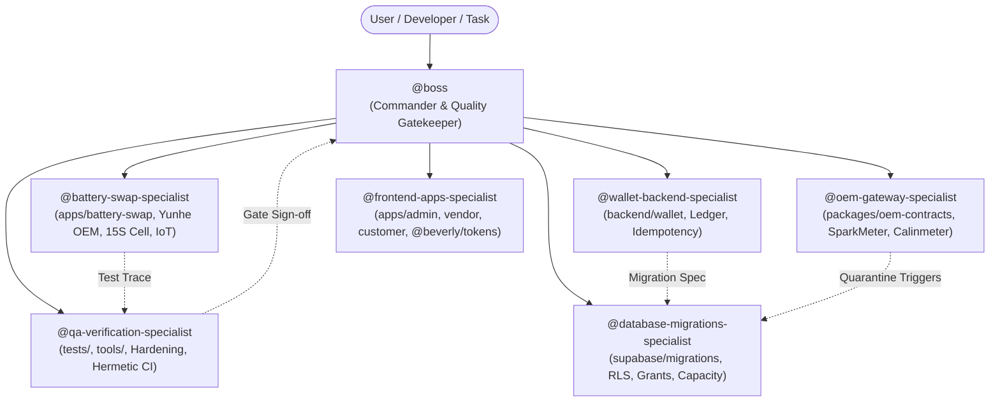

# Beverly Multi-Agent Swarm Topology (`SWARM.md`)

> **Autonomous Specialist Swarm Architecture for Beverly CRM & Monorepo**  
> **Repository**: `acob-lighting-technology-limited/beverly`  
> **Active Branch**: `feat/battery-swap-operations`  
> **Orchestrator**: Boss Agent (`@boss`)  
> **Guiding Standard**: Zero Guesswork, Zero Hallucinations, Verified File Scopes

---

## 1. Verified Architecture & Swarm Hierarchy

The Beverly Swarm is organized strictly around the actual monorepo layout, services, and packages:

---

## 2. Agent Roster & Domain File Ownership

Every agent owns an explicit, verified slice of the repository:

| Agent Identifier | Role Title | Verified Owned Paths & Packages | Key Commands & Test Scripts |
| :--- | :--- | :--- | :--- |
| **`@boss`** | **Commander & Gatekeeper** | Entire repository, `memory.md`, `brain.md`, `ARCHITECTURE.md` | `npm run build`, `npm run hardening:audit` |
| **`@battery-swap-specialist`** | **Battery Operations** | `apps/battery-swap/` (`@beverly/battery-swap-app`) | `node scripts/test-battery-swap-full-trace.js`, port 5177 |
| **`@wallet-backend-specialist`**| **Fintech Ledger Engine** | `backend/wallet/` (`@beverly/wallet-backend`), `backend/src/services/wallet*` | `npm run test:wallet`, `tests/payment-transaction-status-contract.test.cjs` |
| **`@oem-gateway-specialist`** | **OEM Gateways & Telemetry**| `packages/oem-contracts/`, `backend/wallet/src/adapters/`, `oem-telemetry*` | `npm run test:oem`, `npm run test:smart-metering` |
| **`@frontend-apps-specialist`** | **Frontend Portals & Tokens**| `apps/admin/`, `apps/vendor/`, `apps/customer/`, `apps/wallet-landing/`, `packages/tokens/`, `src/` | `npm run test:browser`, `npm run flow:audit` |
| **`@database-migrations-specialist`**| **PostgreSQL & RLS** | `supabase/migrations/`, `supabase/rollbacks/` | `node tests/supabase-migrations.test.cjs`, `npm run database:capacity` |
| **`@qa-verification-specialist`** | **Hermetic QA & Audits** | `tests/`, `tools/`, `.github/workflows/` | `npm run typecheck && npm run hardening:audit` |

---

## 3. Strict Operating Invariants (Anti-Hallucination)

1. **Inspection Precedes Action**: No agent may propose a fix or edit a file without first reading its current contents.
2. **Never Fabricate Values**: Unknown energy measurements, battery cell voltages, or provider transactions must remain explicitly `null` or unconfirmed; never substitute constants.
3. **No Unverified Physical Success**: Never output success confirmations for IoT vehicle immobilizers, locker release, or remote meter cutoffs without verified backend confirmation.
4. **Append-Only Financial Ledger**: Never mutate or delete historical ledger records. Every transaction requires an idempotency key.
5. **Hermetic Test Boundaries**: Default test runners must never reach production external networks or mutate production databases.

---

## 4. Agent Definitions on Disk

- **Antigravity / IDE Location**: [`.agents/agents/*.md`](file:///c:/Users/ACOB/Desktop/VS%20Code/Beverly/.agents/agents/)
- **Claude / Anthropic Location**: [`.claude/agents/*.md`](file:///c:/Users/ACOB/Desktop/VS%20Code/Beverly/.claude/agents/)
- **Dynamic Invocation**: Agents are registered for native invocation via `invoke_subagent`.
