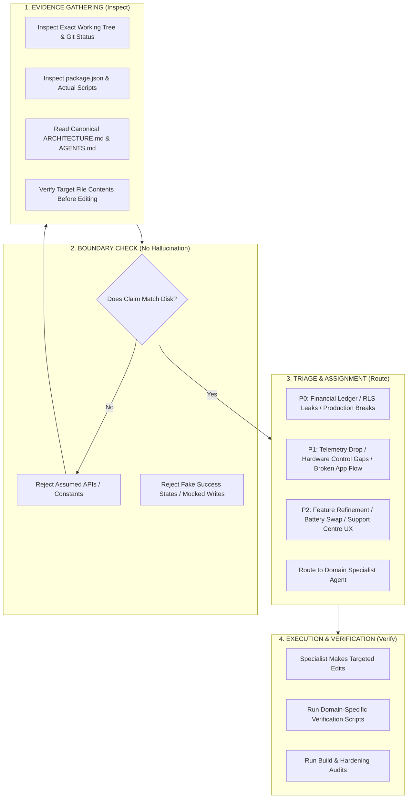

# Beverly Cognitive Engine & Operational Brain (`brain.md`)

> **Executive Cognitive Model & Operational Dispatch Matrix**  
> **Repository**: `acob-lighting-technology-limited/beverly`  
> **Active Working Branch**: `feat/battery-swap-operations`  
> **Core Principle**: Zero Guesswork, Zero Hallucinations, Evidence-Based Action Only

---

## 1. Cognitive Architecture & Anti-Hallucination Framework

Every incoming request, triage operation, or code modification must pass through the verified Beverly cognitive loop:

---

## 2. Priority Classification (Grounded in Risk)

| Level | Severity | Definition | Verification Proof Required |
| :---: | :--- | :--- | :--- |
| **P0** | **Critical Ledger / Security Failure** | Append-only ledger violation, un-idempotent vend, RLS bypass, or leaked service credentials. | `npm run test:wallet`, `npm run test:security`, `node tests/api-authz.test.cjs` |
| **P1** | **Telemetry / Hardware Disruption** | AMR meter drop, SparkMeter quarantine stall, Yunhe battery communication drop, or unverified IoT immobilizer state. | `npm run test:smart-metering`, `npm run test:oem`, `node scripts/test-battery-swap-full-trace.js` |
| **P2** | **App & Portal Functional Delivery** | Battery swap fleet view, customer portal onboarding, support centre call routing, table pagination. | `npm run test:browser`, `npm run test:support-centre`, `npm run build` |
| **P3** | **Design Token & Style Hygiene** | Token mapping in `@beverly/tokens`, contrast adjustments, component cleanups. | `npm run hardening:audit`, `npm run flow:audit` |

---

## 3. Specialist Swarm Dispatch Matrix

Tasks must only be routed to specialists owning the actual directories and services:

| Domain | Assigned Agent | Owned Packages / Directories | Primary Verification Command |
| :--- | :--- | :--- | :--- |
| **Orchestration & Verification** | `@boss` | Entire repository | `npm run build`, `npm run hardening:audit` |
| **Battery Swap Operations** | `@battery-swap-specialist` | `apps/battery-swap/` | `node scripts/test-battery-swap-full-trace.js` |
| **Canonical Wallet Backend** | `@wallet-backend-specialist` | `backend/wallet/`, `backend/src/services/wallet*` | `npm run test:wallet` |
| **OEM Gateways & Adapters** | `@oem-gateway-specialist` | `packages/oem-contracts/`, `backend/wallet/src/adapters/` | `npm run test:oem` |
| **Support Centre & Disputes** | `@support-centre-specialist`| `apps/support-centre/`, `docs/SUPPORT_CENTRE*` | `npm run test:support-centre` |
| **Frontend Portals & Tokens** | `@frontend-apps-specialist` | `apps/admin/`, `apps/vendor/`, `apps/customer/`, `packages/tokens/` | `npm run test:browser` |
| **Supabase Migrations & RLS** | `@database-migrations-specialist` | `supabase/migrations/`, `supabase/rollbacks/` | `node tests/supabase-migrations.test.cjs` |
| **QA, Hardening & Preflight** | `@qa-verification-specialist` | `tests/`, `tools/`, `.github/workflows/` | `npm run typecheck && npm run hardening:audit` |

---

## 4. Active Initiatives on `feat/battery-swap-operations`

1. **Yunhe OEM Battery Swap Pipeline**:
   - Complete 15S cell inspector telemetry, site locker distribution, and IoT immobilizer controls in `apps/battery-swap`.
   - Maintain Vite dev server port 5177 with safe host binding.
2. **Support Centre Africa's Talking Integration**:
   - Ticket escalation and dispute pipeline integration in `apps/support-centre`.
3. **Multi-OEM Contract Integrity**:
   - Maintain runtime contracts in `packages/oem-contracts` for SparkMeter Koios v2 and Calinmeter v1.
4. **Hermetic Test Suite Enforcement**:
   - Prevent default test runs from making unauthorized outbound calls or assuming live network state.
5. **Beverly Bot Alignment & Zero-Hallucination Integrity**:
   - Ensure Beverly Bot (Beverly AI) operates strictly under Beverly ecosystem identity with zero references to external bot brands (never "AcoBot").
   - Enforce grounded policies: relay control blocked for customers/vendors, tamper reset token generation prohibited for all roles via AI, zero measurement/telemetry spoofing, resilient Groq cascade (`openai/gpt-oss-120b` fallback) with offline structured context answering.
6. **WhatsApp-Grade PWA Web Push & Background Delivery**:
   - Push delivery via high-priority wakeups (`urgency: 'high'`) and 24h TTL (`TTL: 86400`) to guarantee delivery when devices are locked or sleeping.
   - WhatsApp-like rich experience: distinct vibration cadence, audible tone, persistent interaction, quick action buttons (`Open`/`Dismiss`), and absolute asset resolution.
   - Device subscription persistence across logout; subscriptions are kept active in PushManager and DB, syncing automatically with customer/vendor sessions upon login.
