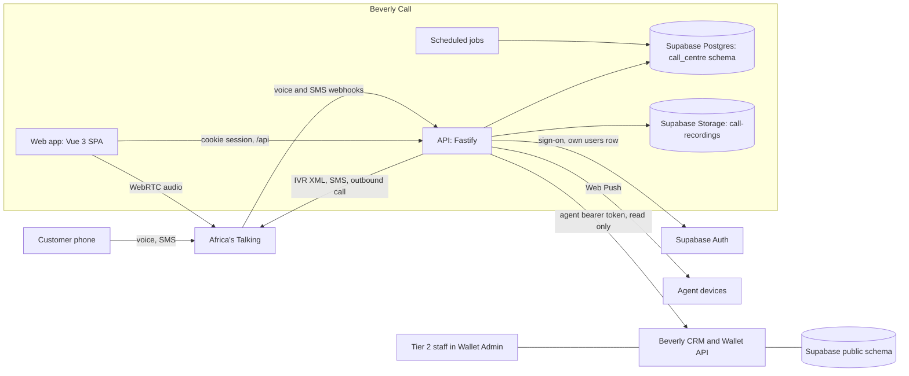
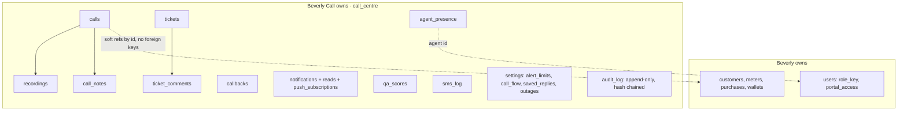
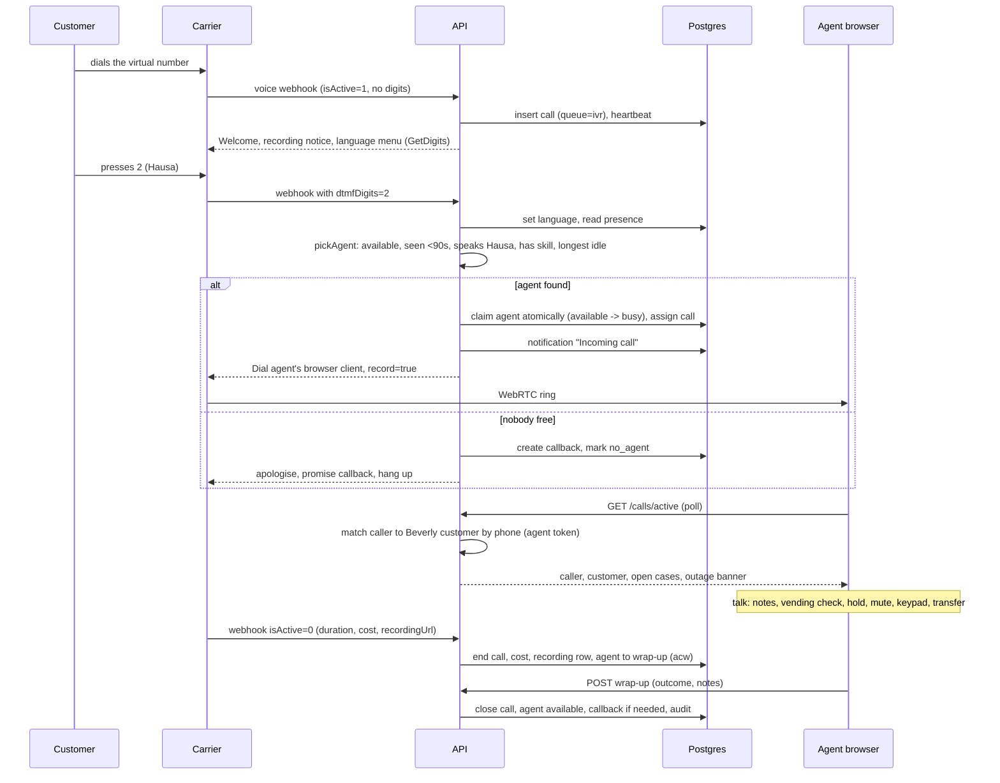
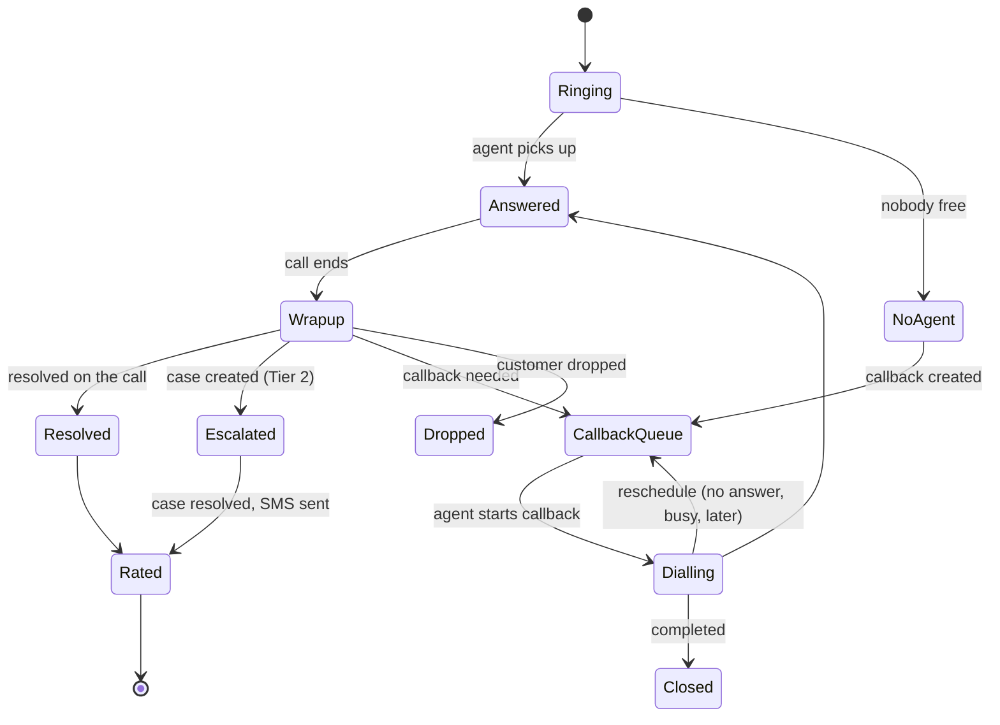

# Beverly Call: System Design

Status: design baseline for build and go-live. Companion to `ARCHITECTURE.md` (what exists in the repo today). This document says what the whole system is, how a call moves through it, and what each person experiences, from the first ring to the last retention purge.

## 1. Purpose and principles

Beverly Call is the support desk for Beverly's prepaid electricity customers. A customer phones in, reaches an agent who speaks their language, gets their problem solved or escalated, and is told when it is fixed. Supervisors watch and coach live. Admins run the rules. Everything is evidenced.

Principles, in priority order:

1. **Never lose a caller.** Every call ends in one of: answered, callback booked, or recorded as abandoned. There is no path where a customer rings and nothing is written down.
2. **Never move money from the desk.** Beverly owns wallets, vending and customers. Beverly Call reads them with the agent's own permissions and escalates anything that moves money to Tier 2.
3. **The server decides.** Roles, access, routing, SLAs and notifications are enforced server-side. The browser is a convenience layer.
4. **Everything sensitive is evidenced.** Token reveals, recording plays, role views, case changes and setting changes land in a tamper-evident audit chain before the action completes.
5. **One shared Supabase, hard boundaries.** Beverly Call owns the `call_centre` schema through a least-privilege role. It holds no copy of CRM data.
6. **Degrade, do not fail.** Carrier down, storage down, Beverly slow: the desk keeps working and says what is unavailable.

## 2. Actors

| Actor | Where they live | What they need |
|---|---|---|
| Customer | Phone, SMS | Fast answer in their language, a case number, a fix notice, a way to rate |
| Agent (Tier 1) | Beverly Call, call screen | The caller's context before they speak, safe actions, one-click wrap-up |
| Supervisor | Live wall, Review | Who is free, who is struggling, SLA risk, coaching, QA |
| Admin | Admin | Call flow, limits, outages, saved replies, retention proof, health |
| Tier 2 staff (wallet, field) | Beverly Wallet Admin | Receive escalations with full context, resolve, notify |
| Carrier (Africa's Talking) | Voice, SMS, WebRTC | Reliable events in, instructions out |
| Beverly | Shared platform | Identity, customers, meters, purchases, staff roles |

## 3. System context

Trust boundaries: the browser is untrusted; the carrier is authenticated by a shared secret; Beverly is called with the user's own token so Beverly's permissions apply; the database role `beverly_call_api` can touch `call_centre` only.

## 4. Building blocks

| Block | Tech | Responsibility |
|---|---|---|
| Web | Vue 3, TypeScript, Pinia, Vue Router, Vite | Agent desk, supervisor wall, review, admin. Own design tokens. Installable PWA |
| API | Node 24, Fastify 5, zod, pg, jose | Sign-on, session, routing, webhooks, business rules, audit |
| Shared | `packages/shared` | One set of zod schemas and types for web and API |
| Jobs | `tsx src/jobs/run-jobs.ts <job>` | `ingest`, `sweep` (every minute); `purge`, `verify-audit` (daily) |
| Data | Supabase Postgres, schema `call_centre` | Calls, tickets, callbacks, recordings, presence, notes, notifications, QA, SMS log, settings, audit |
| Storage | Supabase Storage bucket `call-recordings` | Recording files, signed URLs only |
| Carrier | Africa's Talking behind `CommunicationsProvider` | IVR, dial, recording, SMS, outbound call, WebRTC token |
| Push | Web Push (VAPID) | Alerts when the tab is closed |

The carrier is an adapter, not a dependency of the business rules. Replacing it means one new implementation of `CommunicationsProvider` and one webhook parser.

## 5. Data ownership

Soft references mean Beverly can delete or migrate its tables without ever being blocked by call-centre rows. A customer's call history survives even if the CRM record is merged.

## 6. The call, start to finish

### 6.1 Inbound call (the main pipeline)

Key rules:
- Routing is a pure function (`pickAgent`) so it is unit tested without a carrier.
- The agent is claimed with a conditional update, so two simultaneous calls can never take the same agent.
- A busy agent stays busy until wrap-up, whatever the browser heartbeat says.
- Duplicate carrier events are harmless: calls are keyed by the carrier session id; recordings are inserted once.

### 6.2 Outcomes after the call

### 6.3 Escalation lifecycle (Tier 2)

`OPEN` (SLA clock starts by category: 45 min wallet debited, 60 min token not received, up to 8 h billing) → `INVESTIGATING` (assigned) → `RESOLVED` (resolution note required) → customer SMS "Your case EX-2042 is fixed. How was our service? Reply 1 to 5." → inbound SMS rating saved on the call → feeds leaderboard and QA.

Overdue cases raise an alert once (dedupe key), notify the holder, show on the wall and in Reports.

### 6.4 Sensitive flows

**Token reveal.** Agent ticks name, meter and last vend confirmed, picks a reason and a purchase. API checks all three flags and the reason, fetches the purchase with the agent's own token, writes the audit entry, and only then returns the raw token. If the audit write fails, no token leaves. Rate limit 10 per minute. History everywhere else shows the token masked to the last four digits.

**Recording playback.** Supervisor only. API signs a 5 minute URL for an ingested file and audits the play. Files never pass through the API. A recording not yet ingested returns "still being saved".

**Retention (NDPA).** Daily purge deletes files past 90 days unless on legal hold, marks rows deleted only after the file is gone, retries failures next run, and logs every run as retention proof. Admins see last run, deleted, held, failed and waiting.

### 6.5 Notifications pipeline

Event (assignment, transfer, coaching prompt, QA score, handover, new escalation, no-agent callback) or sweep (overdue case, callback due within 15 minutes, recordings stuck) → stored once per dedupe key → shown in the bell with per-user read state → pushed to subscribed devices when VAPID is set → dead subscriptions removed. Muted categories hide items in the browser. Nothing is seeded or simulated.

### 6.6 Sign-on and session

Staff sign in with Beverly credentials (Supabase auth). The API reads the user's own `public.users` row with their token (`role_key`, `portal_access`), requires `call` in `portal_access` and a mapped role, then issues an httpOnly, SameSite=Strict, signed session cookie holding the Beverly token server-side. Roles: `custom-call-centre-agent` → agent, `custom-call-centre-supervisor` → supervisor, `super-admin` → admin. Admins can preview other views; that is audited and never changes real permissions.

## 7. Experience design

### 7.1 Agent: a shift

1. **Sign in.** One field pair, clear errors, "no call centre access" is explicit. Lands on the Call screen, status Available.
2. **Waiting.** Calm empty state with the agent's status. Break and Away are one tap in the account menu; the status dot is visible everywhere.
3. **Incoming call.** Push and toast. The Call screen shows the caller avatar, name or number, timer, REC marker.
4. **Context chips** (tap any): meter and customer, wallet and recent purchases, open cases, outage banner. Each opens a modal with detail and a shortcut to the customer page.
5. **During the call.** Hold, mute, keypad with tones, transfer to a free colleague (warm or direct), More opens the details panel: Contact (copy, SMS, book callback), Vending (verify, reason, reveal, history), Notes (add, draft summary), Escalate (category, priority, amount, deadline shown).
6. **End.** Wrap-up modal: outcome and notes. Choosing "Callback needed" books a callback automatically. The agent becomes Available again.
7. **Between calls.** Callbacks queue (reschedule with reason, dial, complete), Customers directory (cards or table), My cases, notifications, shift handover, saved replies.

Shortcuts: M mute, H hold, K keypad, T transfer, N notes, Ctrl K search, `?` help, Alt Left back. A floating "On call 02:41, Musa Garba" pill follows the agent to other screens.

### 7.2 Supervisor

- **Live wall.** KPI tiles (active calls, callbacks waiting, agents free, service level, abandoned, overdue). Tapping a tile opens a 24h, 7d or 30d trend. Agents as cards or table, searchable and filterable by state and language. Select an agent to coach; Listen, Whisper, Barge in on a live call; coaching log; alerts driven by admin limits; languages donut; calls per hour with hover read-out.
- **Escalations.** Filter, assign, comment, resolve with note; SLA ring and overdue emphasis.
- **Recordings.** Search, play (signed), hold for legal review.
- **Reports.** Today, 7d, 30d. Calls, handle time, solved first call, cost per call, top issues, busy-hours heatmap, 7-day forecast, leaderboard with ratings, QA sample with scoring, CSV download.

### 7.3 Admin

Call flow editor, alert limits, outages (shown to agents as call banners), saved replies, users (read-only view of Beverly staff with call access, managed in Wallet Admin), connection health, retention proof, audit log with chain verification, number info.

### 7.4 Cross-cutting experience

- Responsive: bottom nav on phones, side rail on desktop, same components. Installable.
- Themes: light, dark, auto by night hours; five palettes; frost or liquid glass; density; text size; high contrast; reduced motion.
- Languages: navigation and titles in English, Hausa, Yoruba, Igbo, Pidgin.
- Privacy by default: phone numbers masked on screens (toggle); session lock after inactivity, never during a call; offline banner.
- Accessibility: keyboard reachable everywhere, focus trapped and restored in dialogs, live regions for toasts, no motion when reduced.
- Strips (KPIs, call flow, chips) hide their scrollbar and glide toward the pointer on hover; touch keeps native swipe.

## 8. API surface (by domain)

| Domain | Endpoints | Roles |
|---|---|---|
| Auth | `POST /auth/login`, `POST /auth/logout`, `GET /session` | all |
| Presence | `PUT/DELETE /presence`, `GET /presence/available` (agent), `GET /presence` (lead) | agent, supervisor |
| Calls | `GET /calls/active`, `POST /calls/:id/wrap-up`, `/transfer`, `GET/POST /calls/:id/notes`, `GET /calls/:id/summary`, `GET /softphone/token` | agent, supervisor |
| Carrier | `POST /webhooks/at/voice`, `POST /webhooks/at/sms` | secret |
| Cases | `GET /cases` (lead), `/cases/mine`, `POST /cases`, `/cases/:id/assign` (lead), `/resolve`, `/comments` | by ownership |
| Callbacks | `GET /callbacks`, `/callbacks/calendar`, `POST /callbacks`, `/:id/reschedule`, `/start`, `/complete` | agent, supervisor |
| Customers | `GET /customers`, `/:id/detail`, `/:id/full`, `POST /:id/notes`, `/:id/token-reveal`, `POST /customers/sms` | all staff |
| Supervision | `GET/POST /coaching`, `GET /coaching/inbox`, `POST /monitor`, `GET /qa/sample`, `POST /qa/:callId` | lead |
| Monitoring | `GET /wall`, `/reports`, `/reports/extras`, `/metrics/:key`, `/recordings`, `POST /recordings/:id/hold`, `GET /recordings/:id/url` | lead |
| Inbox | `GET /notifications`, `POST /notifications/read`, `GET/POST /handover`, `GET /replies`, `GET /outages`, push key, subscribe, unsubscribe | all staff |
| Admin | `GET/PUT /admin/settings/:key`, `/admin/retention`, `/admin/audit/verify`, `/admin/connections`, `/admin/users`, `/admin/number`, `GET /audit` | admin |

## 9. Security and privacy

| Threat | Control |
|---|---|
| Stolen or forged role | Role from Beverly `users` row on sign-in, signed httpOnly cookie, `requireRole` on every route |
| CSRF | SameSite=Strict, Origin check on every write, webhooks exempt and secret-authenticated |
| Credential stuffing | Per-IP login limit, generic failure messages |
| Token leakage | Masked everywhere; reveal needs three checks, reason, audit-first, rate limit |
| Recording exposure | Private bucket, 5 minute signed URLs, audited plays, supervisor only |
| Webhook spoofing | Constant-time shared secret, 401 otherwise |
| SSRF in ingest | https sources only |
| Spreadsheet injection | CSV cells neutralised |
| Tampered audit | Append-only trigger, hash chain, daily verification job |
| Overreach of Beverly Call | `beverly_call_api` role, RLS on every table, no service role, no CRM copy |
| Personal data | NDPA 90 day retention, legal hold, masking, session lock, no secrets in git |

## 10. Reliability and failure behaviour

| Failure | Behaviour |
|---|---|
| No agent free | Callback created, caller told, supervisors alerted |
| Agent browser closes | Presence expires in 90 s, agent leaves the routing pool |
| Carrier webhook retried | Idempotent on session id |
| Beverly unavailable | Context chips show unavailable, call continues, escalation still works with the number |
| Storage unavailable | Playback says unavailable; ingest retries; sweep alerts after one hour stuck |
| SMS fails | Logged as failed; the action that triggered it still succeeds |
| Database slow | 15 s statement timeout on the API role |

Targets: webhook response under 300 ms p95 (IVR is time-sensitive), screens load under 2 s on a mid-range phone, 99.9% monthly API availability, recording loss zero (ingest retries until stored or expired).

Scale assumption: up to 60 concurrent agents and 200 concurrent calls. One API instance suffices; keep it stateless (presence and sessions live in Postgres and cookies) so more can be added behind a load balancer. The notification sweep and opportunistic sweep are idempotent.

## 11. Observability and operations

- Structured JSON logs with request ids; cookies and authorization redacted.
- Health `GET /api/health`; admin "Connections" shows database, Beverly sign-on, carrier webhook last event, carrier API, storage, push.
- Job exit codes drive alerts: purge and ingest fail non-zero when anything failed; `verify-audit` exits 2 on a broken chain.
- Key metrics to chart: webhook latency, calls per hour, abandoned rate, time to answer, ingest lag, overdue cases, push failures.
- Runbooks: carrier outage (callbacks, IVR message), storage outage, audit chain break (freeze and investigate), legal hold request.

## 12. Deployment

| Environment | Web | API | Data |
|---|---|---|---|
| Local | Vite | `pnpm dev:mock` (in-memory Postgres, sample data) | PGlite with the real migrations |
| Staging | Vercel preview | Container host | Beverly staging Supabase, AT sandbox |
| Production | Vercel, public | Container (Dockerfile, health check) behind TLS | Beverly production Supabase |

The browser calls `/api/*` on its own origin; Vercel rewrites to the API host so the cookie is first-party. CI runs typecheck, unit and integration tests, build; e2e runs against the mock stack. Migrations live in the Beverly repo and are applied by Beverly's pipeline; `db/baseline` mirrors them for tests (`pnpm db:sync`).

## 13. Decisions and open questions

| # | Decision | Reason |
|---|---|---|
| D1 | Separate project, shared Supabase | Beverly's documented boundary; shared identity, isolated data |
| D2 | Vue 3 + TypeScript | Matches Beverly's stack and Pinia convention |
| D3 | Own design tokens, not `@beverly/tokens` | Product decision: call desk has its own look |
| D4 | Agents cannot edit customer records | Frontline role is read-only by design; notes only |
| D5 | Presence in Postgres, not memory | Survives restarts and multiple instances |
| D6 | Carrier behind an adapter | Carrier is replaceable |
| D7 | Tests on real Postgres (PGlite) | Found bugs fakes could not |

Open, need an owner outside this repo: confirm RLS lets staff read their own `users` row; confirm Beverly field names for customers, purchases, staff; verify Africa's Talking request shapes (SMS, voice call, WebRTC token, conferencing for listen/whisper/barge) on the sandbox; decide the real supervisor role key and who assigns it; create the `call-recordings` bucket and a bucket-scoped key.

## 14. Roadmap in phases, with end-point goals

Each phase ends when its goal is demonstrable and its acceptance checks pass.

**Phase 0: Foundation (done).** Monorepo, shared contracts, real-database test harness, full API, jobs, migrations, base screens. *Goal: every backend rule above is implemented and tested on real Postgres.*

**Phase 1: Agent desk complete.** Call screen (done), callbacks (list, reschedule modal, calendar, dial, complete), my cases (create from call, comment, resolve), customers (directory cards or table with filters and chips; detail with timeline, notes, case funnel, callbacks, actions: call back, SMS, add note, schedule callback). *Goal: an agent can run a full shift without touching anything outside the app. Acceptance: e2e "inbound call to resolved case with SMS" passes on the mock stack.*

**Phase 2: Supervisor and review.** Live wall (done, to verify), escalations with assign, recordings with hold and playback, reports with heatmap, forecast, leaderboard, QA sample and scoring. *Goal: a supervisor can see, coach, assign, review and score without leaving the app. Acceptance: e2e for coach prompt reaching the agent, QA score notifying the agent.*

**Phase 3: Admin and governance.** Call flow, alert limits, outages, saved replies editors; users and connections panels; retention proof; audit log with chain verification. *Goal: every business rule an admin should own is editable and evidenced. Acceptance: settings changes appear in the audit log and change behaviour (alert, banner).*

**Phase 4: Quality gate.** Update web unit tests and Playwright for the new UI, accessibility pass (keyboard, contrast, reduced motion), phone and desktop layouts, dark mode, performance check, docs. *Goal: green CI (typecheck, unit, integration, e2e, build) and a documented manual QA checklist.*

**Phase 5: Carrier go-live (needs outside inputs).** Apply Beverly migrations; set secrets; verify Africa's Talking on sandbox (IVR, routing, dial, recording, SMS, rating, WebRTC softphone, conferencing for listen/whisper/barge); confirm Beverly field names and RLS. *Goal: a real test call goes from the phone to a resolved case with a rating. Acceptance: sandbox call checklist signed off.*

**Phase 6: Production readiness.** Deploy, observability and alerts, load test at 200 concurrent calls, penetration and privacy review (NDPA), runbooks, training material, pilot with one shift. *Goal: pilot shift runs live with a rollback plan.*
