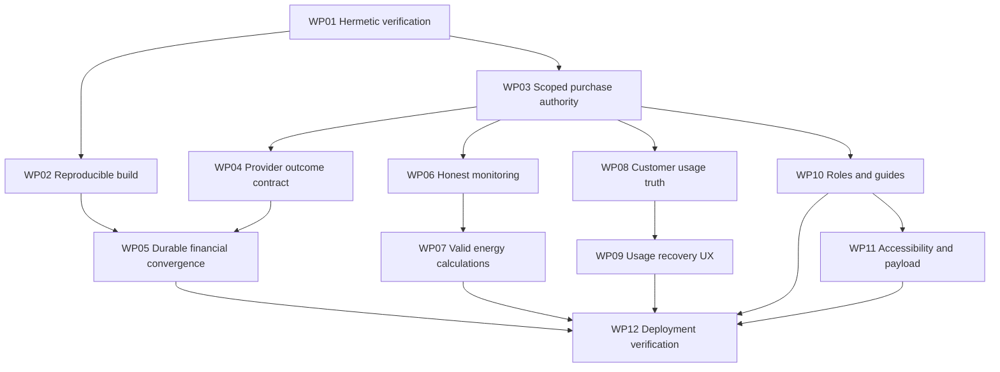

# Beverly master implementation plan

Status: proposed; no fixes implemented.

Source: [weekly audit](BEVERLY_WEEKLY_AUDIT_2026-10-28.md).
Coverage: [inspection matrix](BEVERLY_AUDIT_COVERAGE_2026-10-28.md).

This plan follows observed implementation evidence. It also tests intended domain behavior. Provider wire contracts remain separate authorities. Documentation headings never certify working integration.

## Implementation constraints

- Preserve current production restoration changes.
- Start from freshly inspected repository state.
- Compare actual trees before merging.
- Never force-push or reset production.
- Preserve unrelated worktree changes.
- Keep commits small and reversible.
- Follow canonical architecture and existing conventions.
- Confirm public testing seams before tests.
- Use failing behavior tests first.
- Never mutate production during audit.
- Never resend ambiguous provider payments automatically.
- No unsupported physical-control success messages.
- Never replace unknown measurements with constants.
- Credentials remain outside committed artifacts.

Current audited branch: `feat/beverly-interactive-guide`.
Audited HEAD: `4b20fab4`.
Cached main tree matched that HEAD.
Remote/deployed revisions remain unverified.

## Dependency order

Efforts below are engineering-day estimates. External waiting time is excluded. They are not delivery-date commitments. Reuse existing services before adding abstractions.

## WP01 — Make verification safe

Findings: F14; audit execution incident.

**Outcome:** default checks cannot reach production.

Affected: test environment loader, operational tests, browser harnesses, CI test configuration.

Prerequisites: confirm test boundary and incident investigation owner.

Steps:

1. Inspect incident command read-only.
2. Preserve any resulting audit evidence.
3. Add default outbound denial for tests.
4. Reject production credentials in ordinary suites.
5. Require explicit isolated integration configuration.
6. Remove forced live environment loading.
7. Classify fixture and integration suites clearly.
8. Replace constant/source-only financial assertions incrementally.

Acceptance:

- Sentinel production credentials cannot reach network.
- Default test invocation uses isolated persistence.
- Browser fixture reports identify mocked APIs.
- Incident persistence outcome is documented honestly.

Verification: runner boundary tests and reviewed test entry points. Never reproduce this defect using real credentials.

Compatibility: no application behavior changes required. Keep isolated integration opt-in explicit.

Effort: 1–3 days. Uncertainty: existing runner diversity.

Done: every subsequent verification inherits enforced isolation.

## WP02 — Establish reproducible release builds

Finding: F15.

**Outcome:** complete workspace compiles reproducibly.

Affected: workspace manifests, lockfile, contract package exports/linking, backend and app builds, CI.

Dependencies: WP01. Network/package registry access may be needed.

Steps:

1. Create a clean isolated checkout.
2. Use Node24.x and pnpm10.28.0.
3. Perform frozen dependency installation.
4. Inspect contract-package resolution failure independently.
5. Correct only demonstrated dependency/export defects.
6. Run wallet and every application build.
7. Run actual per-app Vue/TypeScript checks.
8. Collect dispatcher tests successfully.

Acceptance: frozen install succeeds without lock changes. Root, backend, admin, vendor, customer, landing builds succeed. Root typecheck cannot substitute for application checks.

Verification: clean CI artifacts with exact revision, versions, commands, exit codes.

Rollout: no deployment until later gates. Avoid deleting user dependencies or changing global trust settings.

Effort: 0.5–2 days. Uncertainty: local environment versus manifest defect.

Done: previous failure reproduces, cause is established, full clean build passes.

## WP03 — Finish tenant-authorized purchase/discovery

Findings: F02/F03/F18; contract binding gaps.

**Outcome:** actors can use only authorized installations.

Affected: customer/vendor purchase entry points, universal dispatcher, installation resolver, credentials loader, SparkMeter adapter, CRM reads/caches, telemetry queries, discovery.

Dependencies: WP01; approved membership/mapping policy.

Steps:

1. Derive tenant and grants server-side.
2. Resolve exactly one authorized installation.
3. Remove hardcoded inactive-installation exception.
4. Never manufacture active credential context.
5. Bind adapter instance to command installation.
6. Resolve customer/meter/site ownership explicitly.
7. Scope queries and cache keys consistently.
8. Implement complete deterministic station pagination.
9. Reject malformed or foreign cursor scopes.
10. Apply same policy to list/detail/count/export.

Acceptance: two tenants with identical serials remain isolated. Inactive installations reject writes. Missing grants fail closed. Adapter credentials cannot execute another installation's command. All discovery pages converge without omission.

Verification: authenticated purchase/read HTTP tests and real isolated database fixtures. Include missing/ambiguous mapping and station-grant cases.

Migration: inspect existing composite keys/grants first. Add backward-compatible indexes or constraints only if required. Validate existing duplicates before constraints. Rehearse rollback without dropping user records.

Effort: 3–6 days. Uncertainty: deployed grants and existing mappings.

Done: one customer and vendor journey passes positive/negative tenant tests through retrieval.

## WP04 — Certify provider-neutral outcomes

Findings: F17; contract comparison requirements.

**Outcome:** adapter outcomes represent actual evidence.

Affected: shared OEM contract validation, Calinmeter adapter, SparkMeter translator/client, capabilities, request/response fixtures.

Dependencies: WP01/WP03; authoritative API evidence where unavailable.

Steps:

1. Retrieve authenticated current Koios specification when authorized.
2. Record version, date, endpoint, and provenance.
3. Compare actual request/response examples independently.
4. Separate v0, Koios v1, and v2 contracts.
5. Preserve dual-header Koios authentication boundaries.
6. Load settlement currency from trusted installation configuration.
7. Validate amount precision without rounding evidence.
8. Match recipient, reference, currency, amount, payment ID.
9. Keep undocumented processing statuses nonterminal.
10. Replace unconditional Calinmeter status success.
11. Distinguish transport ambiguity from definitive rejection.
12. Preserve STS tokens versus direct credit differences.
13. Document unsupported capabilities explicitly.

Acceptance: invalid, mismatched, missing, duplicate, pending, and malformed evidence cannot settle. No token is fabricated for direct credit. Calinmeter normal vending remains compatible. Unsupported status lookup returns unknown/unsupported, never invented success.

Verification: public adapter contract tests using retained real-envelope shapes. Independently worked money example: 10,000 kobo → NGN100.00. This example establishes no kWh amount.

External gaps: current Koios status finality, write throttling scope, delayed lookup visibility, and actual restricted test-account scope.

Local harness limitation: contract-faithful fixtures verify translation only. They do not establish provider behavior or physical delivery.

Effort: 1–4 days plus external waiting.

Done: every financial outcome has an authoritative evidence rule and passing negative cases.

## WP05 — Close financial recovery completely

Findings: F07/F08.

**Outcome:** provider, ledger, order, receipt converge.

Affected: command persistence, SparkMeter status context, scheduler, ledger hold lifecycle, order states, receipt/outbox publication, support reconciliation views.

Dependencies: WP02/WP03/WP04.

Steps:

1. Reconcile repository and deployed schema evidence.
2. Use canonical request/evidence fields consistently.
3. Remove undefined-column assumptions.
4. Separate provider state from financial completion.
5. Persist every recoverable transition durably.
6. Recover stale leases safely around submission.
7. Reconcile submitted/unknown and post-success settlement failures.
8. Define protected-hold expiry policy explicitly.
9. Capture once after exact provider confirmation.
10. Recover missing receipts/outbox publication idempotently.
11. Expose unresolved cases with actionable evidence.
12. Apply bounded scheduling and concurrency controls.

Acceptance fault cases:

- Crash before provider request: safely resumable.
- Crash after request: lookup original reference.
- Provider success/capture failure: eventual single debit.
- Capture success/receipt failure: eventual single receipt.
- Hold expires during uncertainty: no silent release.
- Lookup404: unknown; no automatic payment resubmission.
- Duplicate worker: single settlement outcome.
- Conflicting provider evidence: operator review.

Verification: actual migrated PostgreSQL plus public purchase/maintenance entry points. Inject faults at each boundary. Assert ledger conservation and durable retrieval independently.

Migration: additive/backward-compatible changes first. Support old pending commands explicitly. Rehearse forward, rollback, and mixed-version execution. Never erase financial evidence during rollback.

Rollout: disable affected writes during incompatible transition. Retain read/reconciliation ability. Rollback code cannot abandon newly created recovery states.

Effort: 4–8 days. Uncertainty: existing unresolved production orders.

Done: every listed failure converges, with one debit and retrievable receipt or explicit unresolved review.

## WP06 — Make operational screens truthful

Findings: F01/F04/F05.

**Outcome:** every displayed fact has provenance.

Affected: CRM dashboard/customer balances, power-quality/demand handlers, mesh services/pages, relay controls, NOVA alerts, diagnostics.

Dependencies: WP03/WP04.

Steps:

1. Remove duplicate power-quality handler ambiguity.
2. Remove synthetic production baselines and balances.
3. Build scoped settled-financial aggregations.
4. Return explicit unavailable/unsupported operational states.
5. Preserve source timestamps and measurement units.
6. Keep demos visibly isolated and opt-in.
7. Disable unsupported relay/power-limit actions.
8. Derive audit actor exclusively server-side.
9. Connect actual diagnostics only with verified contracts.
10. Distinguish requested, acknowledged, and observed equipment states.

Acceptance: empty databases display no invented totals. No provider call means no ping/actuation success. Financial drilldowns equal settled aggregates. Stale readings cannot acquire fresh timestamps.

Verification: public endpoints and visible browser states with network assertions. No production physical action is required for honest unavailable states.

Rollout: truthful unavailable states are reversible. Verified controls require restricted canary approval and rollback capability.

Effort: 3–7 days. Provider control integration may require additional scope.

Done: dashboards and operator actions cannot misrepresent evidence.

## WP07 — Deliver defensible energy reconciliation

Finding: F06.

**Outcome:** losses reflect comparable measured intervals.

Affected: energy-audit API/service/page, telemetry aggregation, tariff snapshots, coverage indicators.

Dependencies: WP03/WP06; confirmed counter/interval semantics.

Steps:

1. Establish authoritative measurement meaning.
2. Select authorized site and exact timezone window.
3. Traverse full bounded dataset deterministically.
4. Align totalizer and customer intervals.
5. Handle resets, duplicates, gaps, late corrections.
6. Remove manufactured hourly curves and tariff guesses.
7. Display coverage and uncertainty explicitly.
8. Avoid unsupported theft accusations.
9. Support reproducible export/drilldown evidence.

Acceptance: known worked datasets reconcile exactly. Zero remains zero. Incomplete coverage blocks definitive loss classification. Financial loss uses verified period tariff or stays unavailable.

Verification: domain tests from independent calculations; scoped database and browser tests.

Migration: version aggregates where interpretation changes. Preserve raw provider evidence. Backfill only after semantic approval.

Effort: 3–6 days plus semantic clarification.

Done: analyst can trace every reported loss to measured inputs.

## WP08 — Finish customer usage semantics

Findings: F03/F09/F10.

**Outcome:** customer sees correct meter facts.

Affected: usage APIs, canonical telemetry, daily consumption, OEM capability resolution, customer Usage/Welcome views.

Dependencies: WP03/WP04; measurement contract evidence.

Steps:

1. Bind claimed meter to installation identity.
2. Reject unknown capabilities instead of guessing OEM.
3. Resolve `usage1` versus canonical-rule conflict.
4. Preserve unresolved energy/credit semantics.
5. Define Lagos daily boundaries correctly.
6. Remove unsupported power/phase assumptions.
7. Rename cached refresh honestly, or implement verified remote job.
8. Preserve actual reading time through responses/UI.
9. Explain missing/stale/fault data clearly.

Acceptance: no foreign meter reading. No monetary credit labeled kWh. Midnight/reset/missing-day examples match requirements. Cache refresh never claims new physical reading.

Verification: public customer API and visible customer journey. Use genuine captured wire shapes with synthetic identifiers.

Compatibility: preserve existing approved Calinmeter interpretation unless authoritative correction requires change. Document explicit API compatibility handling.

Effort: 2–5 days.

Done: customer understands units, period, source age, and refresh result accurately.

## WP09 — Complete usage interaction recovery

Finding: F11.

**Outcome:** selected-meter identity survives network disorder.

Affected: Usage client state, polling lifecycle, empty/error feedback.

Dependencies: WP08.

Steps: introduce request fencing; cancel obsolete requests; prevent polling overlap; clear invalid selections; distinguish stale/error/loading; announce errors accessibly; stop requests on unmount.

Acceptance: delayed A cannot overwrite B. Empty ownership clears prior values. Offline and expired-session cases recover coherently. Retry retains correct scope and selection.

Verification: browser delayed-response, offline, expiry, unmount, rapid-switch tests.

Migration: none expected. Reuse existing report fencing pattern.

Effort: 1–2 days.

Done: visible data always belongs to current authorized selection.

## WP10 — Align roles, navigation, and guidance

Findings: F12/F13; documentation drift.

**Outcome:** permitted users can complete documented tasks.

Affected: central route manifest/policy, CRM and admin guides, navigation, server authorization, architecture/provider status documents.

Dependencies: WP03; approved operations-manager policy.

Steps: reconcile role/group authority; test API and navigation together; replace hash-breaking anchors; correct named dashboard route; filter links by permission; remove unsupported capability claims; document current runtime accurately.

Acceptance: declared allowed roles reach modules. Denied roles cannot call APIs directly. Guide links preserve history, refresh, focus, and route state. Instructions describe actual functionality.

Verification: positive/negative role matrix; browser section links and back/forward/deep-link tests.

Migration: none expected. Avoid broad role expansion without approved authority.

Effort: 1–3 days.

Done: one role policy governs discoverability and execution.

## WP11 — Verify accessibility and payload cost

Finding: F16; unresolved accessibility coverage.

**Outcome:** critical journeys remain usable across devices.

Affected: changed guides/usage/operational screens and route imports.

Dependencies: preceding behavior fixes; WP02.

Steps:

1. Capture screenshots at representative sizes.
2. Audit keyboard and visible focus.
3. Verify labels, announcements, modal focus.
4. Measure contrast and 200% zoom.
5. Honor reduced-motion preferences.
6. Fix demonstrated issues with existing tokens.
7. Measure initial transfer and interaction latency.
8. Lazy-load proven heavy route modules.
9. Compare identical before/after conditions.

Acceptance: critical tasks complete keyboard-only. No obstructing overflow. Errors are announced. Heavy routes do not inflate unrelated initial views unnecessarily. Publish measured payload/timing results.

Verification: browser screenshots, accessibility checks, keyboard execution, performance traces. Fixture overflow tests alone are insufficient.

Effort: 2–4 days. Uncertainty: untested older surfaces.

Done: inspected screenshots and measured checks support every accessibility/performance claim.

## WP12 — Prove release and live recovery

Findings: all release-impacting findings.

**Outcome:** evidence supports a bounded release decision.

Affected: migrations, CI, Vercel configuration, provider test setup, deployed browser/API/database paths, monitoring/runbooks.

Dependencies: WP01–WP11 as applicable. Requires authorized external access.

Steps:

1. Reconfirm deployed branch and restored production changes.
2. Review final diff against actual production base.
3. Run frozen install and complete relevant checks.
4. Rehearse migrations and rollback in isolation.
5. Confirm environment variable names and scopes securely.
6. Deploy preview through authorized release tooling.
7. Smoke browser → API → scoped storage → retrieval.
8. Verify real authenticated provider reads separately.
9. Validate restricted provider test customer/account/token.
10. Authorize any financial canary explicitly.
11. Retain NGN100 ceiling unless superseded.
12. Record exact provider, ledger, receipt evidence.
13. Never automatically reverse test payments.
14. Verify monitoring alerts and recovery ownership.
15. Record rollback trigger and execution evidence.

Provider support recommends testing within ACOB. It specifies an assigned test meter, small separate sales balance, and restricted sell token. A local simulated service is not that environment. A provider test-site name alone proves no isolation.

Acceptance: deployed revision matches reviewed tree. All relevant checks actually pass. Tenant-isolation negatives pass. Financial canary, if authorized, converges exactly once. No physical-delivery claim exceeds observed evidence. Monitoring identifies failures without exposing secrets.

Rollback: restore compatible application version and write flags. Preserve ledger and command evidence. Do not equate code rollback with payment reversal. Compensating financial actions require separate authorization.

Recovery instructions must name job entry points, supported states, reconciliation reference, alert owner, and escalation. Never instruct operators to repeat an ambiguous POST.

Effort: 1–3 days after prerequisites. External access and provider unknowns can extend this.

Done: final release checklist links every claim to commands, logs, database evidence, or observed behavior.

## Test-first execution protocol

Before writing tests, confirm these seams:

- Customer/vendor authenticated purchase endpoints.
- Installation authorization/discovery adapter boundary.
- Provider request and normalized response boundary.
- Maintenance/reconciliation job entry point.
- Real isolated ledger/command database interface.
- Customer telemetry/refresh HTTP boundary.
- Staff controls/diagnostics HTTP boundary.
- Browser visible routes and outcomes.

For each slice:

1. Select one externally observable behavior.
2. Derive expected result independently.
3. Write one failing behavior test.
4. Confirm failure proves the defect.
5. Implement the smallest complete repair.
6. Run focused and affected regressions.
7. Inspect diff and evidence limits.
8. Commit one reversible outcome.

Avoid private-function snapshot tests and source-string assertions for correctness. Mock provider transport only where appropriate. Keep real isolated persistence for schema/state proofs. Distinguish simulated, integration, preview, and production evidence.

## Final handoff evidence

Every work package must record:

- Commit, base revision, and changed files.
- Requirement and authoritative contract version.
- Failing test and corrected outcome.
- Exact commands and exit codes.
- Independent expected examples.
- Migration and rollback evidence.
- Browser screenshots where relevant.
- External verification and explicit exclusions.
- Remaining risks and responsible next action.

No work package is done merely because a page renders. No release is done merely because a fixture passes. Unknown external contracts remain explicit blockers.
