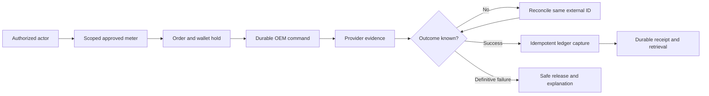

# Beverly weekly implementation audit

## 1. Readiness and consequential findings

**Status: incomplete; release assurance unavailable.**

This audit found critical integrity defects. Physical-control success can be fabricated. Financial recovery can strand successful payments. Tenant selection contains an activation exception. Operational dashboards also contain generated values.

Preserve existing production safeguards during remediation. Do not activate unsupported control capabilities. Do not automatically resend ambiguous payments.

Principal release findings:

| Priority | Finding | Consequence |
|---|---|---|
| Critical | F01: simulated relay success | Operators receive unsupported actuation confirmation |
| Critical | F02: unscoped dispatch selection | Installation authorization lacks required context |
| Critical | F08: financial convergence gaps | Provider success can remain financially unresolved |
| High | F07: recovery/schema mismatch | Recovery queries reference absent columns |
| High | F04–F06: synthetic operational data | Financial and operational decisions become unreliable |
| High | F14: unsafe test configuration | Existing tests can reach live services |
| High | F15: workspace build failure | Combined release build remains unsuccessful |

### Audit execution incident

An existing test loaded live configuration. The audit stopped that execution immediately. Its production-write outcome remains **unverified**.

The responsible test was `tests/oem-grid-control.test.cjs`. Lines 1–2 force environment-file loading. Its simulated relay handler attempted persistence. The handler does not contact SparkMeter. Therefore physical actuation was not demonstrated.

Observed command identifier:
`49cd5546-5f47-46e5-bda2-2a2084732bad`.

Observed meter identifier:
`SMRSD-04-00082E69`.

Approximate execution: October 28, 08:39–08:42 WAT. Console output reported a disconnection message. Database acknowledgement was not established. Neither production mutation nor its absence is proven.

Required follow-up: authorized, read-only database inspection. Search that command identifier and period. Record any resulting audit rows. Do not delete evidence automatically. No real payment was intentionally initiated.

Subsequent checks used scrubbed credentials. Live-write flags were explicitly disabled. No application fixes were made.

## 2. Window, scope, sources, limitations

### Exact audit window

- Timezone: Africa/Lagos, UTC+01:00.
- Week start: October 26, 2026, 00:00:00.
- Week end: November 1, 2026, 23:59:59.
- History cutoff: October 28, 2026, 08:38:19.1962709.
- Later verification occurred during this session.
- Future weekly changes are excluded.

Commit attribution uses committer timestamps. Authored timestamps can differ substantially.

### Audited checkout

- Workspace: `C:\Users\ACOB\Desktop\VS Code\Beverly`.
- Branch: `feat/beverly-interactive-guide`.
- HEAD: `4b20fab4`.
- Initial working tree: clean.
- Cached `origin/main`: `f1aea3e6`.
- HEAD and cached-main trees match.
- Remote freshness was not independently verified.

The former OEM checkout now tracks main. Its HEAD is `a030de93`. Historical handoff branch assumptions are obsolete. No production branch was reset or merged.

### Sources and precedence

1. Current canonical `ARCHITECTURE.md`.
2. Current application and migration sources.
3. Locally available implementation documents.
4. Existing tests and executed results.
5. Local browser observations and fixtures.
6. Local Git history and worktree inventory.

`docs/ARCHITECTURE.md` identifies itself as legacy. Root architecture therefore takes precedence. Nevertheless, root architecture also contains drift. Line 72 describes disconnected SparkMeter dispatch. Current dispatcher code contradicts that statement. This conflict requires reconciliation, not silent assumptions.

Repository `AGENTS.md` and `CONTEXT.md` were absent. Checked parent instruction files were absent. TDD and UI/UX Pro Max were read. Existing design tokens remained the visual baseline. Audit guidance also informed evidence classification.

Explicit requirements include tenant isolation, canonical money writes, approved mappings, evidence-matched payment settlement, and reconciliation before retry. Unsupported provider behavior must fail closed.

Inferred requirements need product confirmation. Examples include freshness thresholds and dashboard inception dates. Optional improvements appear separately below.

### Access and coverage limits

No fresh GitHub or Supabase inspection occurred. Earlier access restrictions were not bypassed. Local refs cannot establish deployed revision. Database migration application remains unverified. Provider responses were not freshly retrieved.

This audit is **not exhaustive runtime certification**. All discovered route declarations were inventoried. Changed high-risk chains received deeper source inspection. Most older product journeys remain unexercised. The coverage appendix makes exclusions explicit.

Some worktrees rejected ownership access. No global trust overrides were applied. Their contents remain excluded.

### Verification ledger

| Exact command | Outcome | Evidence limit |
|---|---|---|
| `npm run typecheck` | Passed | Root configuration only; excludes full Vue coverage |
| `npm run build` | Failed | Wallet compilation stopped combined build |
| `corepack pnpm install --offline --frozen-lockfile --ignore-scripts` | Aborted | `ERR_PNPM_ABORTED_REMOVE_MODULES_DIR_NO_TTY` |
| `corepack pnpm exec vite build` | Passed | CRM only; PWA generation completed |
| `corepack pnpm --filter wallet-backend exec vitest run src/services/__tests__/sparkmeter-payment-client.test.ts src/jobs/__tests__/scheduler-purchase-recovery.test.ts src/adapters/__tests__/universal-oem-dispatcher.test.ts` | Partial failure | 20 tests passed; dispatcher suite failed loading workspace contracts |
| `node tests/oem-energy-audit-mesh.test.cjs` | Passed | Fixture/service assertions; generated data |
| `node tests/oem-grid-control.test.cjs` | Failed safely on rerun | Expected 3,074 meters; isolated inventory returned zero |
| `node tests/oem-telemetry-power-quality.test.cjs` | Passed | Synthetic response contract |
| `node tests/oem-nova-notifications.test.cjs` | Passed | Fixture assertions |
| `node tests/customer-usage-pipeline.test.cjs` | Passed | Source-string checks only |
| `node tests/guide-contract.test.cjs` | Passed | Source-string checks only |
| `node tests/interval-data-flow.test.mjs` | Passed | Existing focused report regression |
| `node tests/interval-report-race.test.mjs` | Passed | Existing stale-response fencing regression |
| `node tests/consumption-sync-service.test.cjs` | Passed | Existing scheduler regression |
| `node tests/dashboard-oem-recognition.test.cjs` | Passed | Mock/local API behavior |
| `node tests/sparkmeter-live-audit.browser.test.cjs` | Passed | All API requests mocked; not live SparkMeter |

The first grid-control execution was interrupted. Its incident is described above. The later isolated rerun failed independently.

Safe reruns blanked Supabase credentials and live tokens. `LIVE_API_ENABLED` and `ALLOW_LIVE_WRITES` were false. Session and local storage used memory. Existing test names do not establish isolation.

The root typecheck excludes important application surfaces. Its success cannot override wallet build errors. Full lint, all-app builds, migration rehearsal, complete security tests, and live smoke remain unexecuted.

The browser fixture covered desktop, tablet, mobile. Sizes: 1440×900, 768×1024, 390×844, 360×740. Assertions covered overflow and console errors. They did not establish visual accessibility compliance.

Screenshot: [isolated local login](audit-evidence/2026-10-28/local-login.png). This image supports only login observations. Authenticated fixture screenshots were not retained. Contrast, keyboard, zoom, and screen-reader compliance remain unverified. No stylistic preference is classified as failure.

## 3. This week's implementation inventory

| Commit / date WAT | Intended delivery | Actual affected chain | Status / dependency |
|---|---|---|---|
| `9cf4cad8`, Oct 26 07:55 | PR207 universal OEM credit | Dispatcher, vending, customer purchase, receipts, registry, CRM | Partial; F02/F04/F08 |
| `2efc26f4`, Oct 26 11:07 | PR208 scheduler fairness | Consumption sync deadlines and regressions | Focused test passed; live scheduling unverified |
| `c447fb79`, Oct 26 11:25 | PR209 operational grid screens | Telemetry, relay, energy audit, mesh, routes | Partial; F01/F05/F06/F13 |
| `5851a9e3`, Oct 26 11:35 | PR210 recovery/capacity documents | Operational planning and evidence documents | Documentation delivered; runtime claims require revalidation |
| `1838b166`, Oct 26 12:02 | PR211 report searches | Interval/report request flow | Focused regression passed |
| `91cb673e`, Oct 26 12:22 | PR212 stale-response fencing | Report request identity and UI results | Focused regression passed; preserve pattern |
| `b1a4a91a`, Oct 26 16:51 | PR213 navigation/NOVA polish | Navigation, bell, responsive browser fixture | Fixture passed; real alert semantics unresolved |
| `6e10cb51`, Oct 27 06:48 | PR215 financial dashboard | Energy and naira dashboard metrics | Partial; F04 |
| `490d2dfe`, Oct 27 07:09 | PR214 customer usage | Customer telemetry routes, capabilities, Welcome | Partial; F03/F09/F10/F11 |
| `c2a8c9f4`, Oct 27 07:16 | PR216 inception metrics | Dashboard totals and labels | Partial; F04 |
| `b54b6dc5`, Oct 27 07:24 | PR217 demand/contrast | Demand cards and dark presentation | Source delivered; authentic metrics unresolved |
| `2c91714f`, Oct 27 07:53 | PR219 claimed-meter usage | Customer telemetry source selection | Partial; scoped identity still incomplete |
| `a030de93`, Oct 27 11:20 | PR218 dashboard inception | Header and cumulative metrics | Source delivered; totals lack provenance |
| `4b20fab4`, Oct 27 17:12 | PR220 guide implementation | CRM/admin guides, navigation, tests, content | Partial; F12/F13/F16 |

Cached main merges guide work as `f1aea3e6`. Matching trees avoid double-counting that merge.

### Uncommitted work elsewhere

The `oem-live-canary` worktree contains four changes. They classify telemetry network/persistence failures separately. Two existing test files also change. Approximate diff: 31 additions, two deletions. Those changes are preserved, not integrated. Their creation dates remain unknown.

`meter-ingestion-recovery` contains untracked modernization documentation. It also contains an untracked confirmation browser test. That unfamiliar test was not executed.

Other accessible worktrees contain documentation and reports. Examples include vendor funding and hardening artifacts. Their presence does not prove current delivery. Several inaccessible worktrees remain unaudited. See coverage exclusions.

## 4. What works well

- Canonical OEM contracts already exist.
- Versioned provider adapters already exist.
- Payment evidence matching is deliberately strict.
- Ambiguous lookup avoids automatic resubmission.
- Durable command foundations already exist.
- Wallet holds separate reservation from capture.
- Explicit customer mappings are represented.
- Telemetry persistence has canonical validation.
- Report stale-response fencing has regressions.
- Consumption scheduler fairness has focused tests.
- Customer claimed-meter checks provide useful groundwork.
- Route metadata centralizes much navigation.
- Guide content improves feature discoverability.
- Existing browser fixtures cover multiple sizes.

These are useful components, not release certification. Preserve them while closing integration gaps.

## 5. Intended versus current behavior

| Area | Intended source | Current behavior | Preserve | Gap | Status |
|---|---|---|---|---|---|
| Universal vending | Canonical architecture; explicit installation authority | Serial lookup plus installation exception | Shared orchestration | F02/F08 | Partially complete |
| Payment reconciliation | Evidence-matched architecture and command schema | Lookup exists; schema/state gaps remain | No blind resend | F07/F08 | Partially complete |
| Relay/power limit | Physical action advertised by UI | Local state and fabricated reference | Confirmation intent | F01 | Missing provider implementation |
| CRM financial summary | Inception labels; wallet ledger authority | Constants plus bounded order slice | Card hierarchy | F04 | Partially complete |
| Power quality/demand | Live telemetry labels | Later handler synthesizes values | Screen structure | F05 | Missing authentic data path |
| Mesh diagnostics | Ping and health affordances | Static devices and alert confirmations | Diagnostic grouping | F05 | Disconnected |
| Energy audit | Time-scoped site reconciliation | Global bounded reads and synthetic fallback | Site comparison concept | F06 | Partially complete |
| Customer usage | Claimed meters; canonical consumption rules | Unscoped serial reads; conflicting units | Claim prerequisite | F03/F09 | Partially complete |
| Remote reading | Live-read success message | Cached retrieval labeled live | User-initiated refresh | F10 | Disconnected provider action |
| Usage interactions | Correct selected-meter identity | Overlapping requests can overwrite state | Report fencing precedent | F11 | Partially complete |
| Guides | In-app discovery and navigation | Hash anchors conflict; admin link mismatch | Modular content | F12 | Partially complete |
| Staff access | Manifest role declarations | Operations group overrides deny new screens | Central role policy | F13 | Partially complete |
| Reports | Search plus stale-response protection | Focused regressions pass | Existing request fencing | Live dataset unverified | Implemented but unverified live |
| Scheduler fairness | Deadline-aware consumption sync | Focused regression passes | Fairness implementation | Deployed execution unknown | Implemented but unverified live |
| Whole deployment | Reproducible workspace build | Combined build fails locally | CRM build passes | F15 | Blocked |

## 6. Prioritized findings

Evidence paths are repository-relative. Line anchors refer to audited HEAD. Severity reflects credible impact, not confirmed exploitation.

### F01 — False physical-control success

**Critical · functionality / safety · confirmed.**

- Origin: this week, PR209.
- Actors: authorized grid-control staff.
- Surfaces: relay and power-limit screens.
- Expected: verified provider acknowledgement before success.
- Actual: process-local overrides produce successful responses.
- Evidence: `api/reference.js:3953`, `:4004`, `:4079`.
- Evidence: fabricated `KOIOS-` reference and succeeded insert.
- Evidence: `src/components/grid-control/RemoteRelayPage.vue` advertises actuation.
- Reproduce safely: isolated handler invocation with fixture inventory. Intercept persistence and outbound traffic. Observe success without provider dispatch.
- Impact: operators believe equipment changed physically.
- Root cause: simulation occupies production handler paths.
- Additional risk: client-supplied operator identity influences auditing.
- Fix: disable unsupported actions explicitly. Implement documented adapter commands only after contract verification. Derive actor identity exclusively server-side.
- Acceptance: unsupported commands cannot report success. Supported actions require durable command evidence. Restart preserves authoritative state. Provider failure remains visible.
- Verify: public HTTP command tests plus isolated provider integration. Physical canary requires separate operational authorization.
- Dependencies: verified control contract; F02/F14.
- Effort: 2–5 engineering days, contract-dependent.
- Confidence: high for implementation defect.

### F02 — Dispatch bypasses installation authority

**Critical · authorization · confirmed missing boundary.**

- Origin: this week, PR207.
- Actors: customer/vendor vending callers.
- Expected: tenant-authorized, active installation selection.
- Actual: active inventory lookup uses serial/external ID. Actor tenant context is absent. A hardcoded installation bypasses inactive status. Credential loading receives manufactured active status.
- Evidence: `backend/wallet/src/adapters/universal-oem-dispatcher.ts:320–364`.
- Compare: `backend/wallet/src/services/oem-installations.ts:80`.
- Reproduce safely: two installations share external identifiers. Give the actor one installation. Exercise public vending using isolated persistence. Assert the unauthorized installation is never selected.
- Impact: namespace collisions can misroute financial operations.
- Root cause: provider selection precedes authoritative authorization.
- Fix: require trusted tenant/installation context throughout dispatch. Reuse existing authorization service. Remove status exceptions. Resolve only explicitly approved ownership mappings.
- Acceptance: duplicate identifiers cannot cross tenants. Inactive installations always reject writes. Payload identity cannot expand caller authority.
- Verify: customer/vendor HTTP tests; two-tenant database fixture.
- Dependencies: approved membership and mapping policy.
- Effort: 2–4 days.
- Confidence: high; live exploitation not attempted.

### F03 — Read paths omit scoped identities

**High · privacy / tenant isolation · confirmed predicates missing.**

- Origin: this week's CRM and usage changes.
- Actors: customers and scoped operational staff.
- Expected: tenant/install/customer-scoped queries and caches.
- Actual: CRM inventory uses hardcoded installation/global cache. Energy reads lack installation filters. Customer telemetry filters external serial alone.
- Evidence: `api/reference.js:3029–3100`, NOVA dispatch near `:7325`.
- Evidence: `backend/wallet/src/routes/customer.ts:2053–2065`, `:2238–2250`.
- Evidence: telemetry identity is installation-composite in migrations.
- Reproduce safely: two installations reuse one serial. Authorize only installation A. Seed distinguishable readings. Query each public read surface; inspect returned identity.
- Impact: foreign readings or counts may appear.
- Root cause: external IDs treated as global IDs.
- Fix: propagate authorized installation scope into queries. Include scope in cache keys. Apply server-side row authorization independently.
- Acceptance: no foreign rows, counts, caches, or alerts. Empty authorized inventory remains empty.
- Verify: positive and negative HTTP/database tests.
- Dependencies: F02 membership resolution.
- Effort: 2–5 days.
- Confidence: high for predicate gaps; leakage unexercised.

### F04 — Financial summaries contain invented values

**High · financial correctness · confirmed.**

- Origin: this week's dashboard/CRM changes.
- Actors: finance, account staff, customer operators.
- Expected: reconciled ledger-derived, period-defined totals.
- Actual: seeded 3,074 accounts and financial baselines. Recent orders are added to constants. Bounded queries lack settled-only aggregation. Direct-credit balances derive from identifier hashes.
- Evidence: `api/reference.js:2825–2880`, `:3246–3260`, `:3303`, `:3400`.
- Additional issue: inventory query references `oem_id`. Inventory associates OEM through installation instead. Error handling hides query failure.
- Reproduce: query isolated empty data. Compare displayed totals against independently calculated zero. Change customer identifier without changing ledger. Observe derived balance change.
- Impact: financial reporting and customer advice mislead.
- Root cause: demo fallbacks presented as authoritative totals.
- Fix: ledger-backed scoped aggregations; explicit coverage dates. Preserve unknown balances as unavailable. Use verified tariff snapshots for forecasts.
- Acceptance: empty data never invents money. Pending/failed orders never count as settled revenue. Totals match independent worked examples across pagination.
- Verify: database aggregation and browser formatting tests.
- Dependencies: F03; finance definition confirmation.
- Effort: 2–4 days.
- Confidence: high.

### F05 — Live telemetry and diagnostics are synthetic

**High · integration / misleading UX · confirmed.**

- Origin: this week, primarily PR209.
- Actors: telemetry, mesh, and support operators.
- Expected: timestamped observed provider measurements.
- Actual: duplicate power-quality declarations exist. The later declaration replaces earlier behavior. Values and curves are generated locally. Mesh devices and radio measurements are static. Ping buttons only show alert messages.
- Evidence: `api/reference.js:3594`, `:4199–4399`, `:7410–7444`.
- Evidence: `backend/src/services/mesh-gateway-service.js:8`, `:270`.
- Evidence: `src/components/mesh/GatewayHealthPage.vue:581–588`.
- Reproduce: isolated empty persistence; request telemetry. Inspect generated readings and fresh timestamps. Click fixture ping; observe no diagnostic request.
- Impact: false operational confidence and wasted dispatches.
- Root cause: demonstration data shares live endpoints.
- Fix: remove duplicate handler ambiguity. Return explicit unavailable/unsupported states. Connect only verified telemetry contracts. Keep demos opt-in and visibly labeled.
- Acceptance: absent telemetry remains absent. Every live value has source/time/unit. Ping success requires actual diagnostic evidence.
- Verify: public API provenance tests; visible interaction assertions.
- Dependencies: F03; verified gateway/control contracts.
- Effort: 3–7 days; external scope uncertain.
- Confidence: high.

### F06 — Energy loss calculations lack valid inputs

**High · analytical correctness · confirmed.**

- Origin: this week, PR209.
- Actors: energy analysts and site operators.
- Expected: aligned site/time energy deltas with coverage.
- Actual: global first 5,000 readings, no requested timeframe. Snapshot values are summed without established counter semantics. Missing/zero data falls back to constants. Hourly curves are manufactured. Loss estimates assume 4% and NGN220/kWh.
- Evidence: `backend/src/services/energy-audit-service.js:156`, `:192–250`.
- Reproduce: same records across different requested timeframes. Include zero consumption and incomplete counters. Compare independent interval calculations with output.
- Impact: inaccurate loss and theft classifications.
- Root cause: illustrative analytics lacks measurement contract.
- Fix: validate units and counter semantics. Align totalizer/customer intervals. Handle resets, gaps, and late records. Report uncertainty; avoid unsupported theft conclusions.
- Acceptance: independently worked examples reconcile. Insufficient coverage prevents definitive loss claims. Verified tariff snapshots support financial estimates.
- Verify: domain calculation tests and scoped integration fixtures.
- Dependencies: F03/F05; data semantics confirmation.
- Effort: 3–6 days.
- Confidence: high for implementation; counter interpretation unresolved.

### F07 — Recovery code contradicts command schema

**High · persistence / recovery · confirmed static mismatch.**

- Origin: older prerequisite, exposed by current activation.
- Actors: wallet users and reconciliation operators.
- Expected: recovery matches deployed canonical schema.
- Actual: scheduler selects `wallet_hold_id`. It writes `response_payload` and `response_received_at`. Adapter selects `request_payload`. Repository migrations do not define those command columns.
- Evidence: `backend/wallet/src/jobs/scheduler.ts:76–87`, `:209`, `:257`.
- Evidence: `backend/wallet/src/adapters/sparkmeter-adapter.ts:188–202`.
- Schema: `supabase/migrations/20260915140000_oem_command_foundation.sql:4–23`.
- Reproduce: migrate an isolated database from repository. Execute maintenance and ambiguous lookup. Observe schema errors rather than mocked rows.
- Impact: stale-hold sweep and reconciliation can fail.
- Root cause: tests model a divergent database contract.
- Fix: align code with canonical request/evidence fields. Add migration only where genuinely required. Verify actual deployment schema before choosing compatibility steps.
- Acceptance: clean migration, maintenance, lookup, and rollback succeed. No undefined command column remains.
- Verify: real isolated PostgreSQL integration tests.
- Dependencies: safe database access; F14.
- Effort: 1–3 days.
- Confidence: high for repository mismatch; live schema unknown.

### F08 — Provider success can strand financial recovery

**Critical · financial lifecycle · confirmed recovery gaps.**

- Origin: this week's dispatcher plus older recovery.
- Actors: customers, vendors, finance support.
- Expected: provider, ledger, order, receipt converge durably.
- Actual: command succeeds before wallet capture. Capture failure leaves pending review. Reconciler selects submitted/unknown commands only. Succeeded commands cannot repair that capture failure. Expired holds reject capture despite reservation protection. Receipt failure also lacks demonstrated convergence.
- Evidence: `backend/wallet/src/adapters/universal-oem-dispatcher.ts:524–555`.
- Evidence: `backend/wallet/src/jobs/scheduler.ts:119–120`, `:209–247`.
- Evidence: `supabase/migrations/20260622140000_wallet_atomic_holds.sql:155–156`.
- Reproduce: provider succeeds; inject capture failure. Run maintenance after hold expiry. Then inspect command, ledger, order, and receipt. Repeat after receipt persistence failure.
- Impact: delivered credit may remain financially unresolved. Customers can remain stuck without receipts.
- Root cause: provider terminal state ends financial recovery prematurely.
- Fix: track provider outcome separately from settlement completion. Recover post-provider failures durably. Handle stale leases and protected reservations explicitly. Never resend ambiguous financial POSTs.
- Acceptance: crash before/after every boundary converges once. Exactly one debit and receipt result. Provider lookup cannot create another payment. Expiry cannot silently release delivered value.
- Verify: public purchase plus maintenance tests. Use actual schema and fault injection.
- Dependencies: F02/F07/F14.
- Effort: 4–8 days.
- Confidence: high; actual live incidence unknown.

### F09 — Customer usage semantics fail open

**High · units / capability correctness · confirmed conflicts.**

- Origin: this week, PR214/219.
- Actors: customers reviewing usage and balances.
- Expected: verified units, time boundaries, explicit capability.
- Actual: missing OEM resolution defaults to Calinmeter/live support. Unknown remote capability is permitted. `usage1` becomes today's consumption despite canonical architecture rejecting it. Provider credit balance is labeled energy without demonstrated units. Fallback intervals can be labeled today despite different dates.
- Evidence: `backend/wallet/src/routes/customer.ts:1938–1976`, `:2076`, `:2140`.
- Requirement: `ARCHITECTURE.md:226` says `usage1` ignored.
- Reproduce: missing capability lookup; midnight Lagos boundary; readings spanning days; provider monetary balance. Compare independently calculated expected outputs.
- Impact: incorrect consumption, balance, and freshness expectations.
- Root cause: permissive defaults and conflicting domain contracts.
- Fix: reject unknown capabilities. Establish provider-specific measurement evidence. Normalize into canonical units. Compute Lagos reporting boundaries explicitly. Represent unknown values honestly.
- Acceptance: no assumed OEM or unit. Counter resets and missing days remain explicit. Required GET/POST capability checks agree.
- Verify: canonical normalization examples and customer endpoint tests.
- Dependencies: F03; authoritative reading semantics.
- Effort: 2–5 days, contract-dependent.
- Confidence: high for code conflict; source units unresolved.

### F10 — Cached retrieval claims live reading

**High · integration / truthfulness · confirmed.**

- Origin: this week, customer usage.
- Actors: customers requesting remote reads.
- Expected: new provider observation or honest cache refresh.
- Actual: `/usage/remote-read` reads stored tables. UI reports live reading received. Client overwrites timestamp with current time.
- Evidence: `backend/wallet/src/routes/customer.ts:2208–2294`.
- Evidence: `apps/customer/src/views/Usage.vue:245–264`.
- Reproduce: freeze stored reading; invoke refresh twice. Observe fresh success without provider traffic.
- Impact: stale information appears current.
- Root cause: refresh and remote actuation are conflated.
- Fix: smallest option: label stored refresh accurately. Preserve source timestamp and data age. Implement remote job only with verified provider support.
- Acceptance: unchanged source retains original observation time. No new reading means no live success claim.
- Verify: endpoint and visible feedback tests.
- Dependencies: F09; product naming decision.
- Effort: 0.5–2 days for honest refresh.
- Confidence: high.

### F11 — Usage requests can overwrite newer selections

**Medium · race / error UX · confirmed missing fencing.**

- Origin: this week, usage UI.
- Actors: customers switching meters or ranges.
- Expected: response identity matches current selection.
- Actual: telemetry loads lack request fencing. Eight-second polling can overlap. Errors only warn; previous data can remain. Some empty states retain stale selection.
- Evidence: `apps/customer/src/views/Usage.vue:216–244`, `:302–309`.
- Contrast: existing daily-report request fencing below that flow.
- Reproduce: delay meter A response. Switch to B; resolve B then A. Inject failure and empty meter list.
- Impact: wrong meter data and misleading continuity.
- Root cause: independent requests mutate shared state.
- Fix: request identity/cancellation and bounded polling. Clear invalid ownership state. Display recoverable stale/error status.
- Acceptance: stale responses never replace current selection. Unmount stops work. Failure identifies stale data explicitly.
- Verify: delayed HTTP browser tests; offline recovery.
- Dependencies: F09/F10.
- Effort: 1–2 days.
- Confidence: high; runtime exploit not exercised.

### F12 — Guide navigation creates dead ends

**Medium · navigation / discoverability · confirmed routing conflict.**

- Origin: this week, PR220.
- Actors: CRM and wallet-admin guide readers.
- Expected: section navigation preserves current route.
- Actual: `#first-week` and `#modules` replace CRM route hashes. Static route resolution falls back to dashboard. Admin guide uses `/dashboard` although dashboard route is `/`. General guide links are not consistently permission-filtered.
- Evidence: `src/components/GuidePage.vue:60`, `:67`.
- Evidence: `src/App.vue:847–896` route handling.
- Evidence: `apps/admin/src/router/index.ts:22`; admin guide dashboard link.
- Reproduce: click guide section links through hash router. Then use back/forward. Open admin dashboard link under permitted roles.
- Impact: guidance redirects users away unexpectedly.
- Root cause: document anchors conflict with routing strategy.
- Fix: route-preserving section scrolling; correct named routes. Filter links through existing permission policy.
- Acceptance: anchors, deep links, refresh, and history work. Restricted modules never appear actionable to unauthorized roles.
- Verify: browser route tests and keyboard navigation.
- Dependencies: F13.
- Effort: 1–2 days.
- Confidence: high for route conflicts; full accessibility unverified.

### F13 — Operations roles lose declared modules

**High · authorization consistency · confirmed.**

- Origin: this week, new route groups.
- Actors: operations managers.
- Expected: route declarations and server policy agree.
- Actual: new routes declare operations-manager access. `operationalGroups` omits their groups. Role override denies them regardless of declaration.
- Evidence: `src/data/route-manifest.js:58–63`, `:129`, `:182–186`.
- Evidence: `api/reference.js:677–710`.
- Reproduce: resolve six new routes as operations-manager. Local route probe returned no allowed new routes. Super-admin retained them.
- Impact: intended operators cannot discover or use modules.
- Root cause: duplicated role/group policy diverged.
- Fix: reconcile explicit approved roles centrally. Keep API and navigation behavior consistent.
- Acceptance: allowed roles reach intended modules. Disallowed roles receive server denial. Guide follows same policy.
- Verify: positive/negative role matrix plus browser navigation.
- Dependencies: product confirms operational authority.
- Effort: 0.5–1.5 days.
- Confidence: high.

### F14 — Tests can load live credentials

**High · audit safety / verification integrity · confirmed.**

- Origin: this week's operational tests.
- Actors: engineers and production operators.
- Expected: default tests cannot contact production.
- Actual: forced environment loading precedes test mode. A relay test reached configured inventory/persistence. Other tests assert generated constants or source strings. The browser named live audit mocks every API.
- Evidence: `tests/oem-grid-control.test.cjs:1–2`, relay POST near `:123`.
- Evidence: `tests/customer-usage-pipeline.test.cjs`; `tests/guide-contract.test.cjs`.
- Evidence: `tests/sparkmeter-live-audit.browser.test.cjs` API interception.
- Reproduce: inspect configuration before any execution. Use outbound deny assertions, never production credentials.
- Impact: test execution risks real state changes. Passing assertions overstate integration assurance.
- Root cause: isolation is implicit and inconsistent.
- Fix: default deny external traffic/credentials. Explicit isolated integration opt-in. Replace tautological assertions with independent observable outcomes.
- Acceptance: sentinel credentials cannot trigger network calls. Tests classify fixture versus live evidence. No default suite imports production secrets.
- Verify: hermetic runner boundary test and suite inspection.
- Dependencies: none; execute first during fixes.
- Effort: 1–3 days.
- Confidence: high; incident persistence remains unknown.

### F15 — Combined build lacks reproducible success

**High · release verification · confirmed environment failure.**

- Origin: uncertain; local dependency state implicated.
- Actors: release engineers.
- Expected: frozen workspace install and full build.
- Actual: wallet compilation cannot resolve `@beverly/oem-contracts`. About 20 TypeScript errors follow. Dispatcher tests fail before collection. Offline installation aborts before repair.
- Evidence: actual `npm run build` output, TS2307.
- Evidence: package script starts wallet build first.
- Reproduce: same checkout and current dependencies. Run full build; observe wallet stop.
- Impact: no all-app build assurance.
- Root cause hypothesis: missing workspace dependency link. Lockfile inconsistency is not proven.
- Fix: clean isolated checkout/install using pinned toolchain. Establish whether linking or declarations are wrong. Change manifests only after that evidence.
- Acceptance: frozen install succeeds; every affected app builds. Dispatcher tests collect and pass. Root-only typecheck is insufficient.
- Verify: Node 24.x / pnpm 10.28.0 clean CI run.
- Dependencies: authorized package registry availability.
- Effort: 0.5–2 days; uncertain environment cause.
- Confidence: high for failure; medium for cause.

### F16 — Eager assets increase initial payload

**Medium · performance · measured cost; regression size uncertain.**

- Origin: partly older; guide adds eager content.
- Actors: mobile and constrained-network users.
- Expected: useful first view without unrelated assets.
- Actual: CRM index is 1,311.56 kB raw. Gzip is 398.66 kB. CSS is 691.30 kB raw. ECharts is 937.81 kB raw. Large guide content is eagerly imported.
- Evidence: completed CRM Vite build output. `src/App.vue` imports; guide module.
- Reproduce: isolated CRM build and chunk report.
- Impact: additional download/parsing cost. User-visible latency was not measured.
- Root cause: broad eager route dependency graph.
- Fix: lazy-load heavy route modules where compatible. Measure before/after on representative devices. Avoid speculative framework rewrites.
- Acceptance: route behavior preserved; first-view payload reduced. Publish reproducible timing/chunk comparisons.
- Verify: production build and browser performance trace.
- Dependencies: correctness work first; F15.
- Effort: 1–3 days.
- Confidence: high for size; impact magnitude unverified.

### F17 — Adapter success exceeds available evidence

**Critical · provider contract / financial outcomes.**

- Origin: this week's adapter extraction; parser origin uncertain.
- Actors: wallet users and recovery operators.
- Expected: confirmed success requires provider-confirmed outcome.
- Actual: Calinmeter `getVendStatus` always returns success. It performs no lookup. Its exception path classifies every vend exception as confirmed failure. SparkMeter normalization accepts both `processed` and `processing` as success, although retained evidence establishes only `processed` as the confirmed example.
- Evidence: `backend/wallet/src/adapters/universal-oem-dispatcher.ts:168–179`.
- Evidence: `backend/wallet/src/adapters/sparkmeter-v1.ts:271–276`.
- Reproduce: call Calinmeter status with nonexistent command. Supply matched SparkMeter evidence with `status=processing`. Observe confirmed-success outcomes without demonstrated finality.
- Impact: false settlement or unsafe hold release.
- Root cause: adapter outcomes exceed supporting evidence.
- Fix: real Calinmeter lookup or explicit unknown/unsupported. Classify transport ambiguity separately from definitive rejection. Keep SparkMeter processing pending/unknown until authoritative finality is established.
- Acceptance: nonexistent commands never succeed. Transport timeouts never prove rejection. Unsupported statuses cannot authorize capture. Preserve verified Calinmeter happy-path behavior.
- Verify: public adapter contract and purchase-recovery tests. Obtain authoritative status definitions separately.
- Dependencies: F07/F08; provider evidence review.
- Effort: 1–3 days; external verification uncertain.
- Confidence: high for Calinmeter defect. SparkMeter finality is an evidence gap, not a newly verified provider guarantee.

### F18 — Station pagination silently drops resources

**Medium · universal adapter completeness · confirmed.**

- Origin: this week, adapter extraction.
- Actors: installation discovery and synchronization jobs.
- Expected: paged adapters expose every available station.
- Actual: both adapters slice first `limit` items. Both always return null continuation. Cursor input is ignored. SparkMeter reads inventory without paginated traversal, which can also encounter server row limits.
- Evidence: `backend/wallet/src/adapters/universal-oem-dispatcher.ts:99–108`.
- Evidence: `backend/wallet/src/adapters/sparkmeter-adapter.ts:88–117`.
- Reproduce: seed more stations than requested limit. Traverse returned pages; later stations never appear.
- Impact: incomplete discovery appears complete.
- Root cause: page envelope without continuation semantics.
- Fix: deterministic scoped pagination with validated limits. Preserve cursor scope and stable ordering. Distinguish cached inventory discovery from provider discovery.
- Acceptance: all stations appear exactly once. Invalid/foreign cursors reject. Empty inventory returns genuine completion.
- Verify: multi-page public adapter contract tests.
- Dependencies: F02/F03.
- Effort: 1–2 days.
- Confidence: high.

### Independent SparkMeter contract comparison

This comparison answers the subsequent user clarification. Existing documentation is evidence, not unquestioned truth. Required behavior, canonical adapter contracts, provider contracts, and runtime translation are evaluated separately.

Fresh official access was attempted during audit. `https://sparkmeter.cloud/docs/api/` was inaccessible through the available web reader. Fresh authenticated Koios/OpenAPI retrieval therefore remains blocked. Retained authenticated observations are historical evidence only. They are not newly verified live behavior.

The accessible [official legacy API](https://api.sparkmeter.io/) describes ThunderCloud/GroundBolt API v0 and `Authentication-Token`. This positively establishes version differences. It does **not** certify Koios dual-header payment behavior. Unrelated Cardano Koios documentation is excluded.

Retained evidence sources:

- `docs/SPARKMETER_PAYMENT_CONTRACT.md`, October 23.
- `docs/SPARKMETER_KOIOS_V2_VERIFIED_CONTRACT.md`, September 27 with October 7 correction.
- User-supplied support ticket CH-82160 screenshots.
- Actual translator, client, adapter, and normalizer sources.

Those documents also contain stale implementation statuses. Their status headings cannot prove present connectivity. The October 7 wire correction supersedes the earlier simplified reading description. Directly observed nested wire fields outrank illustrative schema summaries where they conflict.

SparkMeter supplies metering and electricity-credit services. Beverly owns its wallet ledger and customer journey. Sending SparkMeter customer credit is distinct from funding a Beverly wallet. API acceptance, processed credit, and physical meter delivery remain distinct events.

| Boundary | Required / retained provider contract | Actual implementation | Assessment |
|---|---|---|---|
| Universal identity | Trusted tenant plus active installation; canonical contracts explicitly require authorization | Dispatcher serial lookup and status exception | F02; implementation contradicts shared contract |
| Adapter instance | Credentials and endpoint belong to one installation | `findMeter`/`vend` trust incoming installation ID independently of constructor ID | Add strict equality checks; prevent mixed identity/credentials |
| Capability | Unknown/unsupported operations reject | Core capability utility fails closed; customer fallback permits live support | Preserve utility; fix F09 |
| Vending strategy | Canonical outcome supports optional token | SparkMeter direct credit and Calinmeter STS are distinguished | Preserve; never fabricate an STS token |
| Payment auth | Retained Koios evidence: `X-API-KEY`, `X-API-SECRET` | Payment client sends both; redirect errors enabled | Source alignment; current provider access unverified |
| Payment request | `POST /api/v1/customers/{customer_id}/payments`; decimal-string amount, memo, external ID | Builder encodes customer ID; formats minor units to two decimals | Source alignment; independently verify settlement currency |
| Amount example | NGN100 equals 10,000 kobo | `10000` becomes decimal string `100.00` | Correct representational example; not a tariff/kWh conversion |
| Currency authority | Trusted installation settlement currency | Adapter passes command currency as settlement currency | Comparison becomes tautological; load independently verified configuration |
| Customer mapping | Assigned customer and meter; organization ownership | Adapter requires active mapped customer | Useful check; tenant binding still incomplete |
| Creation response | Retained example: HTTP201, payment envelope | Client accepts 200/201 before strict parsing | Extra acceptance requires provenance; not proof of provider behavior |
| Evidence matching | Payment ID, recipient, amount, currency, immutable external ID | Parser checks these using integer decimal comparison | Preserve exact matching; F17 status gap remains |
| Payment finality | Retained confirmed example: `processed` | Parser additionally accepts `processing` | Unsupported finality expansion; F17 |
| Reference recovery | GET `/api/v1/payments?external_id=...` | Client performs read-only lookup | Correct strategy; F07 trusted-context retrieval broken |
| Ambiguous POST | No automatic resubmission; missing lookup is inconclusive | Client sends one POST; lookup404 remains unknown | Preserve; no borrowed Calinmeter guarantees |
| Read retry | Bounded lookup, respect provider delay | Three attempts, backoff, Retry-After handling | Useful boundary; shared load/jitter still needs assessment |
| Write throughput | Support says actual write limits pending | Static timeouts/backoff do not certify write capacity | Confirm limits; conservative shared budget until then |
| Payment reversal | Separate mutation; support recommends test reversals | Must remain separately authorized and audited | Never automatic cleanup or refund equivalence |
| Provider test setup | Support: assigned test meter, small sales account, scoped sell token; no separate sandbox offered | Current account/token isolation not freshly verified | External execution gate; local harness cannot substitute |
| V2 telemetry reads | Read-only POSTs to live/historical organization endpoints | Adapter sends filters/per_page/cursor to those paths | Do not treat every POST as financial mutation |
| Reading wire shape | October7 evidence: nested `site`, `meter.serial_number`, customer ID; state enum values | Canonical normalization must match retained real envelope | Require captured-envelope replay and fresh portal comparison |
| Energy semantics | `energy` described as total; counter-versus-interval unresolved | Canonical contract preserves unknown semantics; analytics infer totals/deltas | F06/F09 violate uncertainty preservation |
| Credit semantics | Currency/unit unspecified in retained V2 schema | Customer presentation assumes energy balance | F09; never infer kWh from money |
| Pagination | Retained V2 cursor/expiry rules; universal complete page envelope | Telemetry carries cursor; station adapters terminate early | F18; full traversal/checkpoint execution unverified |
| Physical cutoff | No verified offline cutoff guarantee | Advisory helper explicitly avoids guaranteeing cutoff | Preserve caveat; test firmware/network behavior separately |

Universal contracts should accept provider-neutral, validated identities, money, units, timestamps, capabilities, pagination, and explicit outcomes. Provider adapters translate those into version-specific wire contracts. Shared domain logic must not accept arbitrary provider JSON as financial evidence. A nonempty reference string alone cannot establish provider truth.

Further contract checks belong in the master plan. They must cover request rejection, response envelopes, unexpected statuses, monetary precision, account scope, cursor expiry, retries, and persisted recovery. No provider guarantee is inferred from a mock.

## 7. Page and feature coverage

See [complete coverage appendix](BEVERLY_AUDIT_COVERAGE_2026-10-28.md).

Inventory contains 168 route declarations. Aliases and catchalls are included. This is not 168 verified journeys. Hidden developer routes, background jobs, integrations, and unresolved worktrees are explicitly classified there.

## 8. Current and target journeys

### Identity and lifecycle baseline

Actors include CRM super-admin, operations-manager, account staff, wallet administrators, permissioned finance staff, developers, vendors, vendor users, and customers.

Core identities: tenant, membership, OEM manufacturer, installation, external site/customer/meter mapping, approved customer meter, and station grants. Financial entities: wallet, hold, ledger, purchase order, command, receipt, refund, settlement. Operational entities: reading, daily snapshot, raw event, quarantine record, cursor, task, and health snapshot.

State authority must remain server-owned. Session expiry must never expand permissions. Provider acceptance differs from ledger settlement. Stored freshness differs from live observation.

### A. Customer/vendor electricity purchase

Actor needs an approved meter and balance. Entry: customer Buy Token or vendor Vend. Inputs: meter, amount, authorized scope, confirmation. Validation includes ownership, currency, limits, and capabilities.

Current: portal → purchase service → universal dispatcher → serial-selected installation → hold → provider → command success → capture → receipt. Exceptions can leave pending review. Retrieval depends on order/receipt persistence.

Target: portal → authorized installation/meter → idempotent order/hold → durable command → provider evidence → durable settlement recovery → single capture → single receipt → history retrieval. Unknown outcomes remain pending with reconciliation. Cancellation before dispatch releases safely. After possible dispatch, reconciliation precedes release or retry.

Handoffs: customer/vendor sees pending status; finance sees actionable reconciliation. Provider credit must never be inferred from a token-shaped response. F02/F07/F08 block this journey's assurance.

### B. Telemetry ingestion and customer usage

Actor: customer with approved claimed meter. Background prerequisite: authorized installation credentials and verified reading contracts.

Current: ingestion adapters → canonical persistence → customer serial-only lookup → conversions/defaults → Usage display. Remote Read retrieves cache and claims freshness. Overlapping loads can replace newer selections.

Target: provider → versioned adapter → authenticated ingestion → installation resolution → canonical unit/time validation → deduplication → scoped atomic persistence/checkpoint → authorized customer API → identity-fenced UI. Invalid records quarantine visibly. Backfill and incremental runs converge. Refresh preserves observation time.

Success: correct meter, units, period, age, provenance. Failure: explicit unavailable/stale status, retry without identity confusion. Handoff: support sees scoped ingestion stage and quarantine evidence. F03/F09/F10/F11 apply.

### C. Remote grid control

Actor: expressly authorized operational staff. Entry: relay/power-limit screen. Inputs: meter, requested state, reason. Current chain stops at local override and attempted command insertion. Visible success precedes physical evidence.

Target: server authorization → verified capability → durable intent → provider submission → acknowledgement/readback → persisted evidence → user confirmation. Unsupported providers show unavailable actions. Cancellation and timeout cannot fabricate equipment state. Recovery reconciles before repeat submission. F01/F02/F05/F13 apply.

### D. Operational monitoring and energy audit

Actor: site-scoped operations/analyst. Entry: telemetry, demand, mesh, alerts, energy audit. Current screens consume generated metrics or mixed synthetic/database results. Filters do not consistently define time/scope.

Target: authorized site/time selection → scoped observed readings → coverage validation → documented aggregation → timestamped display → diagnostic request or evidence-backed alert → operator acknowledgement. Missing data remains unknown. Late records recompute deterministically. Financial estimates require matching tariff snapshots. F03/F05/F06 apply.

### E. Financial dashboards and CRM customers

Actor: permitted finance/account staff. Entry: dashboard, customer/account lists. Current data combines baselines, recent orders, and hash-derived balances.

Target: authorized aggregation → settled ledger/order facts → explicit reporting window → reconciled totals → drilldown records. Customer balances come from verified balance sources. Loading/error/empty states preserve provenance. Handoff: discrepancies become reconciliation cases. F03/F04 apply.

### F. Reports, searches, and consumption scheduling

Actor: scoped report reader. Entry: prepay and administrative reports. Inputs: station, meter, period, data item. Existing changed reports include request fencing. Focused search/race/fairness regressions passed.

Target acceptance remains broader: exact period semantics, authorized scope, complete pagination, export parity, empty/error recovery, refresh/history behavior, and cancellation. Scheduler must preserve fairness while retrying bounded failures. Live service/database execution was not verified.

### G. Guides and navigation

Actor: authenticated staff/customer as permitted. Entry: Guide or contextual help. Current guide links can leave the guide unexpectedly. Operations roles can lose declared destinations.

Target: permission-filtered discovery → route-preserving sections → accurate task instructions → authorized destination → browser back returns coherently. Keyboard focus follows navigation. Reduced motion honors preferences. Guidance describes real capabilities only. F12/F13 apply.

### H. Remaining discovered product families

These flows were inventoried, not fully exercised. No completion claim follows from their presence.

| Family | Actor / prerequisites | Current entry and handoff | Target acceptance / recovery |
|---|---|---|---|
| Sign-in/recovery/setup | Staff/vendor/customer; valid identity | Portal auth routes → role session → home | Reset, MFA, expiry, logout, return URL tested |
| Vendor onboarding | Applicant/reviewer; permission grants | Applications → review → vendor details | Decision/audit persists; duplicate/rejected recovery |
| Wallet funding | Customer/vendor/finance; wallet | Fund → provider redirect/webhook → balance | Verified callback, exact-once credit, pending retrieval |
| Wallet administration | Finance; wallet permission | Wallets/funding/transfers → audit | Scope, maker/checker, concurrency, reversal verified |
| Meter claims/approval | Customer/reviewer; ownership proof | Onboard/claim → approval → available meter | Rejection, duplicate ownership, revocation propagate |
| Meter procurement | Customer/vendor/admin | New order → pricing/payment → fulfillment | Stock/payment/order convergence and cancellation |
| Receipts/transactions | Wallet owner/authorized staff | Histories → detail → export | Scoped retrieval, correct totals, stable pagination |
| Refunds/disputes | Customer/support/finance | Submit → investigate → decision | Ownership, evidence, exact-once financial outcome |
| Settlements/reconciliation | Finance; elevated grants | Queue → matched records → closure | Durable recovery; independent ledger agreement |
| Customer/vendor administration | Authorized staff | Lists → details → account changes | Server scope, validation, audit, conflict handling |
| KYC/fraud/privacy | Customer/reviewer/admin | Submission → checks → policy decision | Sensitive data restricted; appeals/retries clear |
| Notifications/support | Customer/vendor/staff | Bell/inbox/help → record/action | Genuine source, read state, scoped retrieval |
| Profile/security/settings | Account holder/admin | Profile → credentials/preferences | Verified changes, session invalidation, clear errors |
| Roles/permissions | Authorized administrator | Policy editing → navigation/API enforcement | Same allow/deny decision across every surface |
| Legacy tokens | Scoped CRM staff | Generate → task/token → record | Approved meter, audited mutation, retrievable result |
| Legacy remote tasks | Scoped CRM staff | Read/control/send → task record | Real provider outcome; timeout/retry reconciliation |
| Infrastructure management | Scoped operations | Gateway/customer/tariff/account/station tools | Validated changes, dependencies, scoped persistence |
| Protocol/support tooling | Authorized technical staff | DLMS/DLT645/GPRS/load/event/firmware/file pages | Capability limits, upload safety, task evidence |
| Developer console | Developer-only grants | OEM/API/webhook/log/queue/schema tools | Production route policy; no secret exposure |
| Landing/public pages | Public visitor | Welcome/terms/privacy → correct portal | Accessible links; honest content; auth return flow |

Each row requires source-to-runtime verification later. Scope includes inputs, persistence, authorization, feedback, retrieval, cancellation, retry, and cross-role handoffs. Current details beyond inspected chains remain uncertain.

## 9. Missing, skipped, incomplete, unverified

**Delivered:** source-level modules listed in section 3. **Preserve:** components listed in section 4.

**Incomplete:** tenant propagation, financial convergence, authentic monitoring, customer semantic normalization, navigation, and role alignment.

**Missing within advertised flows:** verified relay actuation, genuine mesh ping, trustworthy telemetry provenance, complete energy-audit input handling, and demonstrated post-provider recovery.

**Disconnected:** physical control and diagnostics interfaces. Cached Remote Read lacks provider action.

**Visually present but functionally misleading:** relay, ping, live metrics, remote-read freshness.

**Technically present but poor UX:** unfenced usage requests and route-breaking guide anchors.

**Confirmed this-week defects:** F01/F02/F04/F05/F06/F09–F14. **Older exposed gaps:** F07 and portions of F08. **Origin uncertain:** F15 and much of F16. No historical before/after runtime comparison proves deployed regressions.

**Planned but unfulfilled:** canonical architecture explicitly requires scoped authorization and evidence-based financial settlement. Current exceptions conflict with those requirements. Other missing functions are not called skipped without planning evidence.

**Unverified:** deployed commit, production migrations, current provider contracts, actual credentials scope, real payment/relay behavior, all-role browser journeys, keyboard/screen-reader compliance, full mobile visual review, offline behavior, load behavior, complete regressions, and inaccessible worktrees.

## 10. Dependency-ordered implementation plan

See [master implementation plan](BEVERLY_MASTER_FIX_PLAN_2026-10-28.md).

Order: isolation → reproducible builds → tenant boundary → financial recovery → authentic data → customer semantics → roles/navigation → accessibility/performance → deployment evidence.

No fixes or new tests are authorized by this audit request. The plan is actionable without implying execution.

## 11. TDD and end-to-end verification plan

**Seams require confirmation before new tests.**

Proposed public seams:

1. Customer/vendor purchase HTTP boundary.
2. Authorized installation resolution boundary.
3. Maintenance/reconciliation job entry point.
4. Migrated database ledger/command interface.
5. Provider adapter documented request/response boundary.
6. Customer telemetry and refresh HTTP boundary.
7. Staff grid/diagnostic HTTP boundary.
8. Portal browser routes and visible feedback.

For each behavior: failing test first. Then minimal implementation and passing verification. Refactor only after preserving the outcome.

Expected values must come from independent examples. Never copy constants from implementation. Use two tenants with colliding external identifiers. Inject failures around every financial boundary. Exercise pagination, late data, empty data, timezones, resets, timeouts, throttling, and duplicate delivery.

Local provider harnesses prove contract behavior only. They never prove provider availability. Live canaries require authorized accounts and boundaries. No ambiguous POST may be blindly repeated.

Browser acceptance includes loading, empty, error, permission, expiry, slow network, offline, refresh, back/forward, deep links, cancel, retry, and retrieval. Capture screenshots before visual judgments. Test keyboard, focus, labels, announcements, zoom, contrast, and reduced motion separately.

## 12. Justified enhancements

| Priority | Improvement | Evidence / value | Dependencies / effort | Tradeoff / measurement |
|---|---|---|---|---|
| After correctness | Shared freshness/provenance display | Multiple screens obscure source age | F04/F05/F09; 1–2 days | More metadata; fewer false-live interpretations |
| After recovery | Reconciliation case timeline | Financial states span several records | F07/F08; 2–4 days | Added UI scope; reduced unresolved-case time |
| After scoping | Scoped operational overview | Operators need actionable gaps | F03/F05; 2–3 days | Query cost; measure diagnosis time |
| After routing | Contextual guide links | New guide improves discoverability | F12/F13; 0.5–1 day | Content upkeep; task-completion rate |
| After build | Route-level lazy imports | Measured bundle cost | F15/F16; 1–3 days | More chunks; first-view timing reduction |

These are enhancements, not hidden requirements. Broad rewrites are not recommended.

## 13. Open decisions and required evidence

- Confirm authoritative reporting inception and statuses.
- Confirm provider energy and balance units.
- Confirm supported remote-control operations.
- Confirm intended operations-manager authority.
- Confirm customer refresh naming and capability.
- Obtain authorized deployed revision/schema evidence.
- Inspect the audit-incident command read-only.
- Confirm test seams before implementation.
- Select isolated migration rehearsal database.
- Establish live verification boundaries separately.

Do not infer payment retry guarantees. Existing strict lookup rules remain controlling. Calinmeter behavior cannot establish SparkMeter guarantees.

## 14. Release-readiness checklist

- [ ] F14: default tests cannot reach production.
- [ ] Incident: actual persistence outcome established.
- [ ] F15: frozen install and all-app builds pass.
- [ ] F02/F03: tenant collision tests pass.
- [ ] F07: real schema integration passes.
- [ ] F08: every crash boundary converges once.
- [ ] F17: only evidenced terminal outcomes settle.
- [ ] F18: adapter discovery traverses complete inventory.
- [ ] Contract matrix: currency/installation bindings verified.
- [ ] F01: unsupported controls cannot claim success.
- [ ] F04/F05: displayed facts have provenance.
- [ ] F06: loss calculations match independent examples.
- [ ] F09/F10: units, dates, freshness verified.
- [ ] F11: delayed responses preserve selection identity.
- [ ] F12/F13: role/navigation matrix passes.
- [ ] Accessibility and visual review completed.
- [ ] Migration apply/rollback rehearsed safely.
- [ ] Full affected regression suite passes.
- [ ] Authorized preview smoke reaches real services.
- [ ] Deployed revision and configuration recorded.
- [ ] Recovery, monitoring, and rollback demonstrated.

None of these unchecked gates implies completion. This document records an investigation and plan. It does not authorize production activation.
